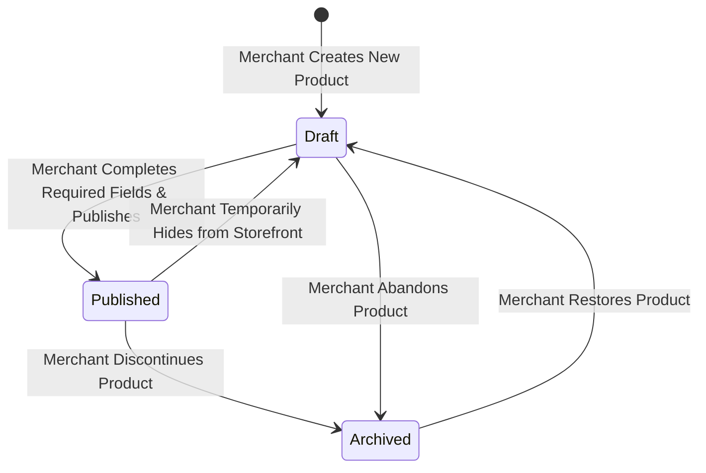
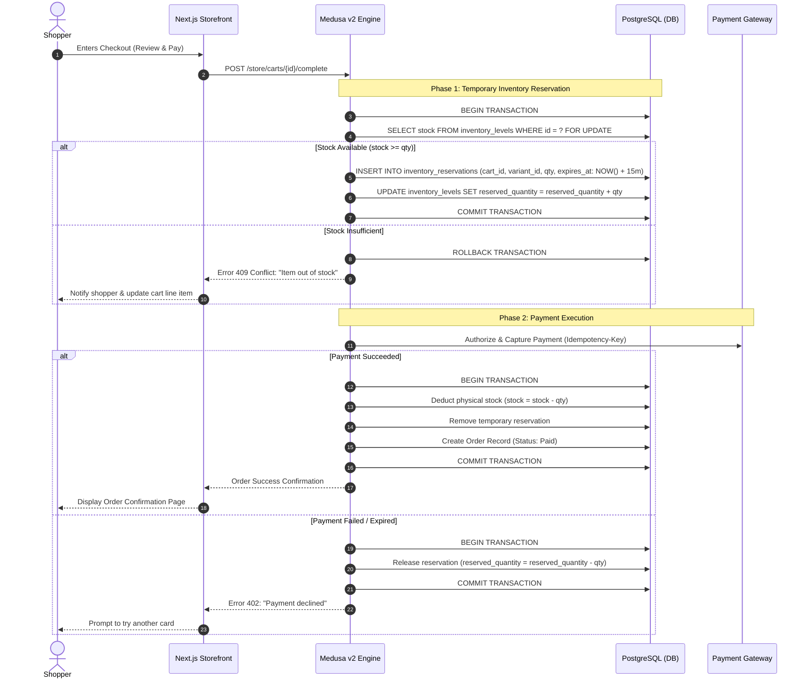
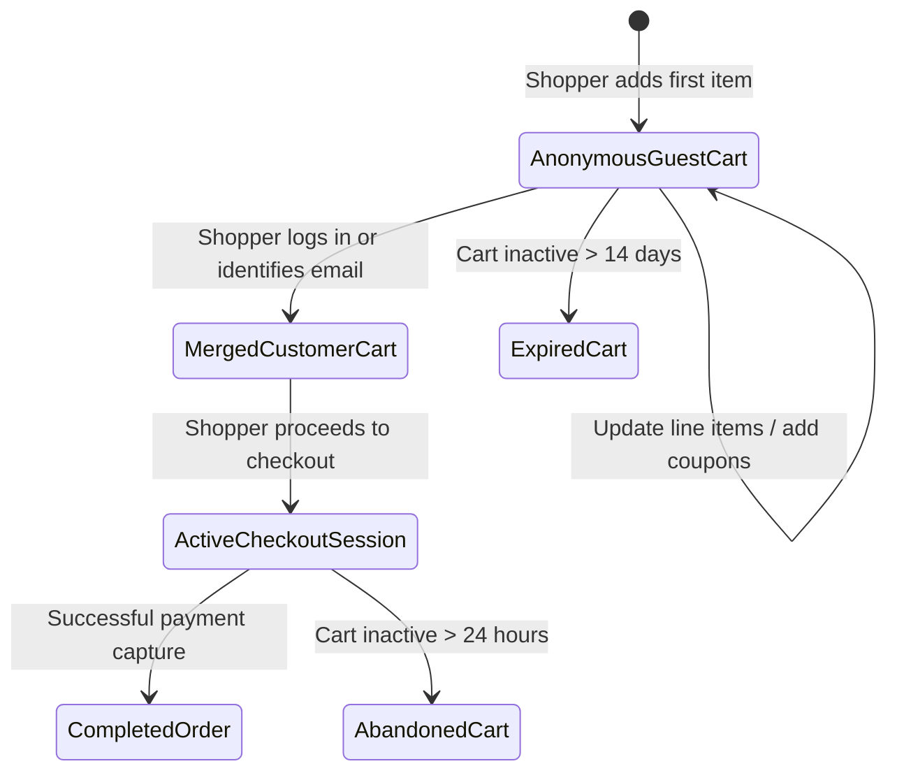
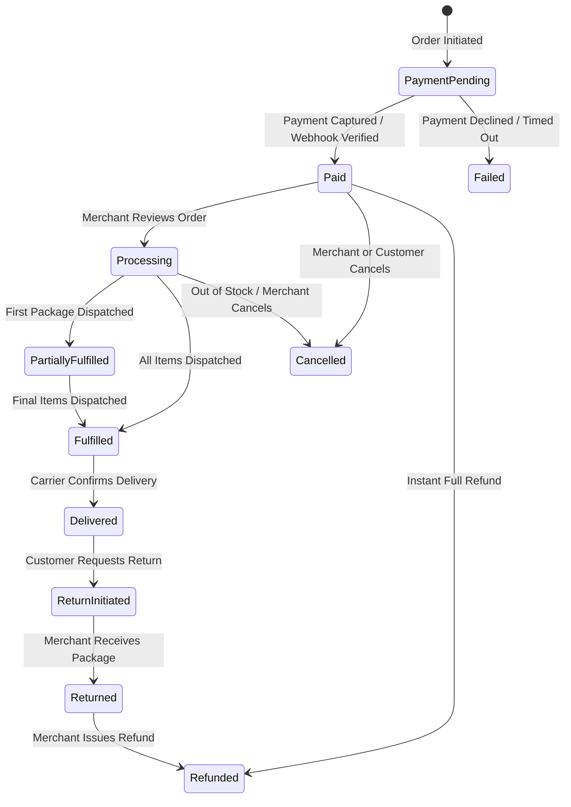

# Commerce Workflows & State Machines

**Project**: The Ecom Buddy  
**Document**: Commerce Workflows & State Machines Specification  
**Status**: Approved for Architecture Review  
**Milestone**: 01 (Foundation & Technical Specification)  
**Author**: Principal Software Architect & Senior E-commerce Product Engineer  

---

## 1. Executive Summary

This document specifies the exact business logic, state transitions, concurrency controls, and failure compensation routines governing core commerce operations across **The Ecom Buddy**. 

Every workflow is designed to prevent race conditions, avoid overselling high-demand stock, guarantee payment idempotency, and provide frictionless recovery paths when customer or third-party service errors occur.

---

## 2. Product & Variant Lifecycle Workflow

### 2.1 State Transition Model
Products transition through three distinct lifecycle states: `Draft`, `Published`, and `Archived`.

### 2.2 Variant Matrix Generation & SKU Consistency
When creating products with multiple options (e.g., Size: S, M, L $\times$ Color: Navy, Olive):
1. **Cartesian Product Generator**: The system automatically computes the full variant matrix ($S \times C = N$ variants).
2. **Deterministic SKU Creation**: SKUs are automatically suggested following the pattern:  
   `[PRODUCT_SLUG]-[OPTION1_VAL]-[OPTION2_VAL]` (e.g., `LNN-SHIRT-NVY-M`).
3. **Price & Weight Inheritance**: Base price and weight are inherited from the parent product unless explicitly overridden at the variant level.
4. **Media Mapping**: High-resolution gallery images can be pinned to specific variant colors so selecting a swatch on the frontend immediately swaps the active PDP gallery image.

---

## 3. Inventory & Reservation Lifecycle Workflow

### 3.1 Concurrency & Race Condition Prevention
In high-volume flash sales or limited-inventory scenarios, multiple shoppers may attempt to purchase the final unit simultaneously. The Ecom Buddy uses a **two-phase inventory reservation mechanism**:

### 3.2 Inventory TTL Auto-Cleanup Worker
* A background cron worker evaluates active reservations every 60 seconds.
* Any reservation where `expires_at < NOW()` and no successful order has been attached is automatically released back to the general pool, preventing abandoned checkouts from artificially depleting merchant inventory.

---

## 4. Shopping Cart Lifecycle Workflow

### 4.1 Price Snapshotting Rule
When an item is added to a cart:
* The unit price, applied currency, and tax rate are **snapshotted** into the `cart_line_items` record.
* If a merchant modifies a product's price in the admin catalog while a shopper is active, the cart validates prices against catalog changes prior to checkout completion, alerting the user transparently if a price update has occurred.

### 4.2 Discount & Promotional Code Engine
* **Validation Rules Evaluated in Order**:
  1. *Code Validity*: Code exists, is active, and current date is within `[starts_at, ends_at]`.
  2. *Usage Limits*: Total usage count $< \text{max\_limit}$ and customer usage count $< \text{per\_customer\_limit}$.
  3. *Cart Requirements*: Cart subtotal meets minimum spend threshold; cart contains eligible categories or products.
* **Stacking Policy**: By default, one promotional coupon can be applied per checkout to prevent discount stacking exploits.

---

## 5. Checkout & Payment Workflow

### 5.1 4-Step Checkout Flow
1. **Step 1: Customer Contact & Delivery Details**
   * Email address (mandatory for CAPI event matching and digital receipts).
   * Shipping destination: Country, State/Province, City, Postal Code, Street Address, Apartment/Suite, Phone Number.
2. **Step 2: Shipping Method Selection**
   * Real-time calculation of available shipping methods based on customer shipping zone and total order weight/subtotal.
   * Free Shipping automatically pre-selected if cart subtotal exceeds the merchant's configured threshold.
3. **Step 3: Billing Address**
   * Default: *"Same as shipping address"*.
   * Option to specify independent tax/billing address.
4. **Step 4: Payment Execution & Tokenization**
   * Payment provider selection (Stripe Credit Card / Apple Pay / Google Pay, Razorpay, or Cash on Delivery).
   * Secure credit card tokenization via Stripe Elements iframe.

### 5.2 Payment Idempotency & Webhook Resilience
To prevent duplicate charges caused by erratic mobile internet connections or repeated button clicks:
* A cryptographically unique **Idempotency Key** (`cart_id + version + timestamp`) is transmitted with every payment authorization request.
* **Webhook Redundancy**: If the customer closes their browser before the redirect returns, the backend listens to Stripe's `payment_intent.succeeded` webhook. The webhook triggers the identical order creation workflow safely using the same idempotency lock.

---

## 6. Order Fulfillment & Processing Workflow

### 6.1 Merchant Fulfillment Actions
1. **Generating Documents**: In the merchant admin, clicking **"Generate Packing Slip"** creates a clean, printable PDF containing customer shipping address, order items, SKU codes, and merchant brand logo.
2. **Dispatching Packages**: Merchant inputs carrier name (e.g., FedEx, DHL, USPS, BlueDart) and Tracking Number.
3. **Customer Alert**: An automated transactional email is instantly dispatched containing the carrier tracking hyperlink.

### 6.2 Refund & Restock Automation
When an order or specific line item is refunded:
* Merchant selects refund amount (Full or Partial).
* Checkbox: **"Restock returned items into inventory"** (default checked).
* If checked, the system increments `inventory_levels` atomically and writes an audit log entry.
* Refund is issued through the original payment gateway API without the merchant ever handling card details.

---

## 7. Merchant & Customer Notification Workflows

| Trigger Event | Recipient | Channel | Payload / Template |
| :--- | :--- | :--- | :--- |
| **Order Paid** | Customer | Email | Order confirmation, itemized receipt, shipping address, order tracking link |
| **Order Paid** | Merchant | Email / Dashboard | New order notification, customer name, total amount, items purchased |
| **Order Shipped** | Customer | Email | Shipping confirmation, carrier tracking number, direct tracking URL |
| **Low Stock Threshold** | Merchant | Email / Dashboard | Warning: Variant SKU has dropped below configured threshold ($N$ units remaining) |
| **Order Refunded** | Customer | Email | Refund notice, amount credited, original payment method details |
