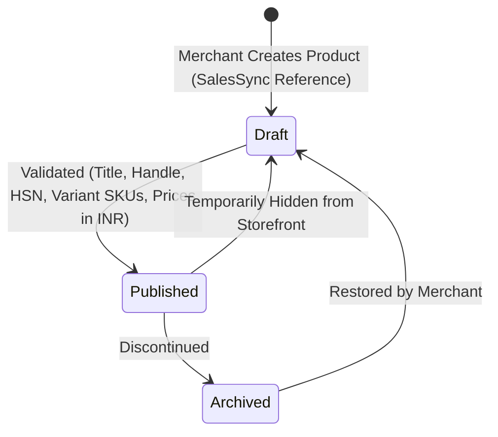
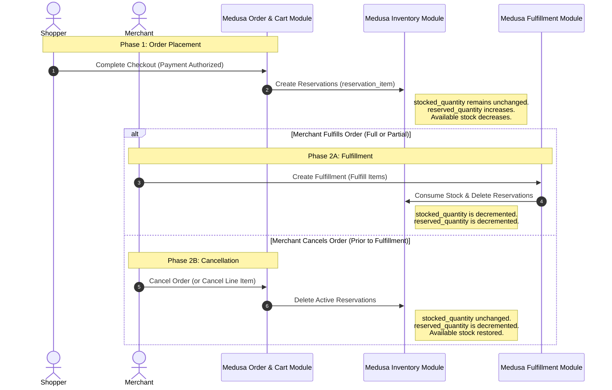
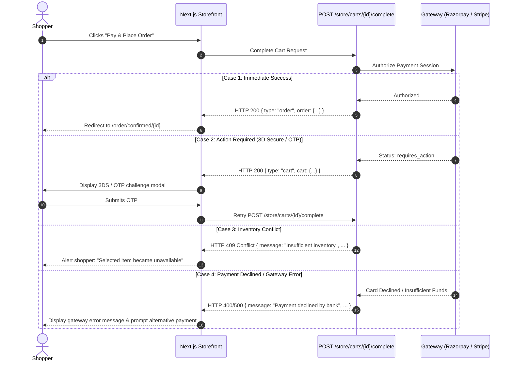
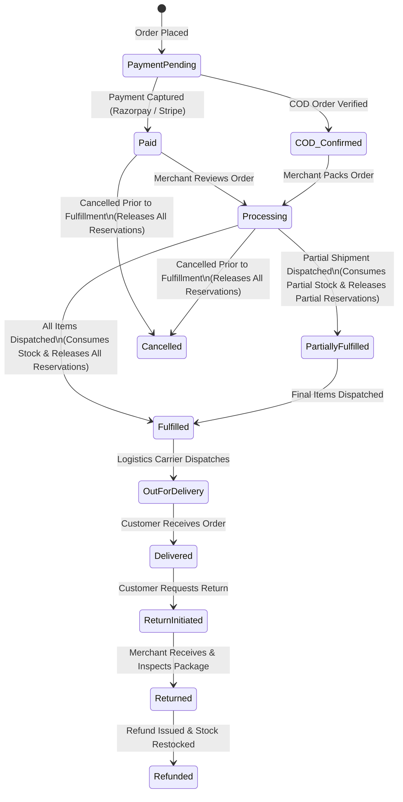

# Commerce Workflows & State Machines

**Project**: The Ecom Buddy  
**Document**: Commerce Workflows & State Machines Specification  
**Status**: Revised Architecture Specification (Final Step 01 Technical Corrections)  
**Milestone**: 01 (Foundation & Technical Specification)  
**Author**: Principal Software Architect & Senior E-commerce Product Engineer  

---

## 1. Executive Summary

This document specifies the business workflows, transactional state machines, inventory lifecycle, and checkout error handling governing **The Ecom Buddy**. 

In strict adherence to **Medusa v2** standards, all core commerce operations (inventory reservations, cart completion, payment authorization, fulfillment, and refunds) utilize Medusa's official **Workflows Engine** with durable execution and compensation functions.

---

## 2. Product & Variant Lifecycle Workflow (500+ Products Scale)

### 2.1 State Transitions & Scale Requirements
* **Catalog Capacity**: The catalog supports a minimum of **500 distinct products** per merchant. With multi-attribute variants (Size $\times$ Color $\times$ Material), typical merchant catalogs span **1,500 to 4,000+ distinct sellable SKUs**.
* **Product Status States**: `Draft`, `Published`, and `Archived`.
* **Variant Matrix Generation**: When a merchant creates options (e.g., Size: S, M, L $\times$ Color: Navy, Olive), the admin interface generates the full variant combination matrix.
* **SKU & Barcode Conventions**: Deterministic SKU generation formatted as:  
  `[PRODUCT-HANDLE]-[OPTION1-VALUE]-[OPTION2-VALUE]` (e.g., `LNN-SHIRT-NVY-M`).
* **HSN & Tax Classification**: Each product is assigned an Indian HSN (Harmonized System of Nomenclature) code (e.g., `6205` for Men's Shirts) to automate GST classification.

---

## 3. Official Medusa v2 Inventory & Reservation Lifecycle

### 3.1 Accurate Medusa v2 Inventory Lifecycle
Medusa v2 strictly decouples inventory reservation from physical stock consumption:

1. **Cart Browsing & Inactive Carts**:
   * Adding items to a shopping cart does **not** create inventory reservations. Stock remains unreserved while a shopper browses or abandons a cart prior to checkout completion. We do **not** assume an automatic reservation TTL for abandoned carts.
2. **Order Placement (`completeCartWorkflow`)**:
   * When an order is placed and payment is authorized, Medusa's inventory workflow creates **Inventory Reservations (`reservation_item`)** linked to the stock location's `inventory_level` for each managed variant.
   * Available stock is calculated as:
     $$\text{Available Quantity} = \text{stocked\_quantity} - \text{reserved\_quantity}$$
   * The physical stock (`stocked_quantity`) is **not** decremented at order placement; it is protected by the reservation.
3. **Order Fulfillment (`createFulfillmentWorkflow`)**:
   * When the merchant packs and fulfills an order (or partial order), Medusa's fulfillment workflow **consumes physical stock** (`stocked_quantity` is decremented) and **releases (deletes) the corresponding reservations**.
4. **Order Cancellation (`cancelOrderWorkflow`)**:
   * If an order is canceled before fulfillment, Medusa automatically **releases (deletes) all active reservations**, instantly restoring the available stock.
5. **Partial Fulfillment & Partial Cancellation**:
   * **Partial Fulfillment**: When only a subset of order line items is fulfilled (e.g., 1 of 2 items in split shipment), reservations for fulfilled items are consumed and released, while reservations for the unfulfilled items remain active.
   * **Partial Cancellation**: When a specific unfulfilled item in an order is canceled, only that item's reservation is released.
6. **Returns & Restocks**:
   * If an order is returned after fulfillment, the return workflow increments `stocked_quantity` back to the inventory level upon merchant inspection and receipt.

---

## 4. Checkout Progression & Error Handling (Medusa Complete Cart API)

### 4.1 Medusa v2 Complete Cart API Response Behavior
The storefront invokes `POST /store/carts/{id}/complete` to finalize the checkout. In accordance with official Medusa v2 specifications, the response varies based on workflow outcome:

1. **Order Success (`HTTP 200 OK`)**:
   * Returns `{ type: "order", order: OrderDTO }`.
   * The cart is marked as completed, payment is authorized/captured, and inventory reservations are created. The storefront redirects the customer to the order confirmation page.
2. **Action Required (`HTTP 200 OK` with `type: "cart"`)**:
   * In multi-step or 3D-Secure payment flows (e.g., Stripe 3D-Secure card authentication, Razorpay modal challenge), the API returns `{ type: "cart", cart: CartDTO, error?: { message, code, type } }`.
   * The payment collection's status transitions to `requires_action`.
   * The storefront inspects `payment_session.data` and prompts the customer to complete 3DS authentication or provider challenge. Once completed, the storefront retries completion.
3. **Workflow & Validation Failures**:
   * Medusa does **not** collapse all failures into HTTP 402 or 409. Status codes adhere to standard REST error responses with structured error bodies `{ message: string, type: string, code: string }`:
     * `HTTP 400 Bad Request`: Incomplete cart data (missing shipping address, missing shipping method, or invalid tax state).
     * `HTTP 409 Conflict`: Inventory allocation conflict (e.g., insufficient unreserved inventory at the designated stock location).
     * `HTTP 500 / Provider Error`: Payment gateway gateway communication failure or system error.
   * The storefront handles each error type contextually, displaying user-friendly feedback without losing cart line items or entered delivery addresses.

### 4.2 Webhook Idempotency, Retries & Reconciliation
* **Webhook Processing**: Payment webhooks (e.g., Razorpay `payment.captured`, Stripe `payment_intent.succeeded`) are delivered asynchronously. Medusa's payment provider plugins process webhooks using deterministic idempotency keys (`payment_session.id`). Duplicate webhook deliveries are acknowledged with `200 OK` without triggering duplicate order creation.
* **Payment Authorization Retries**: When an authorization is declined, the customer's cart remains intact. The customer can retry with UPI, Netbanking, or another card.
* **Payment Reconciliation**: An automated background reconciliation routine polls pending payment sessions older than 30 minutes against Razorpay/Stripe APIs to capture any authorizations whose browser redirect was interrupted by mobile network drops, finalizing the order safely.

---

## 5. India-First Checkout & Commerce Workflows

### 5.1 Four-Step Checkout Progression
1. **Step 1: Contact & Delivery Address (India-First)**
   * Mobile phone number (mandatory for Indian logistics SMS tracking) and Email address.
   * Delivery destination:
     * Full Name & Street Address.
     * Flat/Building No. & Landmark.
     * 6-digit **PIN Code** (with automated asynchronous lookup for City and State).
     * State/Union Territory dropdown (all 28 states & 8 UTs).
   * Optional: B2B Business Name and 15-character **GSTIN** for tax invoice credit.
2. **Step 2: Shipping Method Selection**
   * Real-time calculation based on delivery PIN code and destination zone:
     * *Local / Metro Express* (1–2 business days).
     * *Standard Surface (Rest of India)* (3–5 business days).
     * *Free Shipping* (automatically applied when order subtotal exceeds merchant threshold, e.g., ₹1,499).
3. **Step 3: GST Tax Calculation (Place of Supply Rules)**
   * The tax engine dynamically computes tax based on the merchant fulfillment warehouse location (supplier location) and delivery address (place of supply) under Section 10 of the Indian IGST Act:
     * If Supplier Location State = Place of Supply State $\rightarrow$ **CGST** (e.g., 6%) + **SGST** (e.g., 6%).
     * If Supplier Location State $\ne$ Place of Supply State $\rightarrow$ **IGST** (e.g., 12%).
   * Displayed clearly before final payment authorization.
4. **Step 4: Payment Authorization**
   * **Razorpay**:
     * **UPI**: Instant QR code display on desktop; UPI Intent app switch (Google Pay, PhonePe, Paytm, CRED) on mobile.
     * **Netbanking**: Direct redirect across major Indian banks.
     * **Cards**: RuPay, Visa, Mastercard with mandatory 3D-Secure OTP verification.
   * **Cash on Delivery (COD)**:
     * Validated against merchant's PIN code whitelist.
     * Optional flat or tiered COD convenience fee (e.g., ₹50).
     * Optional phone verification OTP to reduce RTO (Return to Origin) rate.
   * **Stripe**: International card processing and Apple Pay for overseas customers.

---

## 6. Order Fulfillment, Returns & Refund Workflow

### 6.1 Merchant Fulfillment Actions
* **GST Tax Invoice & Packing Slip**: Non-technical merchants can generate a tax-compliant Indian GST invoice (PDF) in one click from the admin dashboard, displaying:
  * Merchant GSTIN, PAN, and registered dispatch location address.
  * Customer billing address and optional customer GSTIN.
  * Itemized line items with HSN codes, taxable value, CGST/SGST/IGST rates, and amounts in INR (`₹`).
* **Logistics Tracking**: Merchant enters carrier name (e.g., Shiprocket, Delhivery, BlueDart) and Tracking Number/AWB. Automated transactional SMS and Email are dispatched to the customer.

### 6.2 Refund & Restock Automation
* When issuing refunds via the admin:
  * Merchant specifies refund amount (Full or Partial).
  * Checkbox: **"Restock returned items to inventory"** (default checked).
  * Medusa's official refund workflow automatically issues the credit via Razorpay/Stripe API and increments physical inventory (`stocked_quantity`) atomically.
