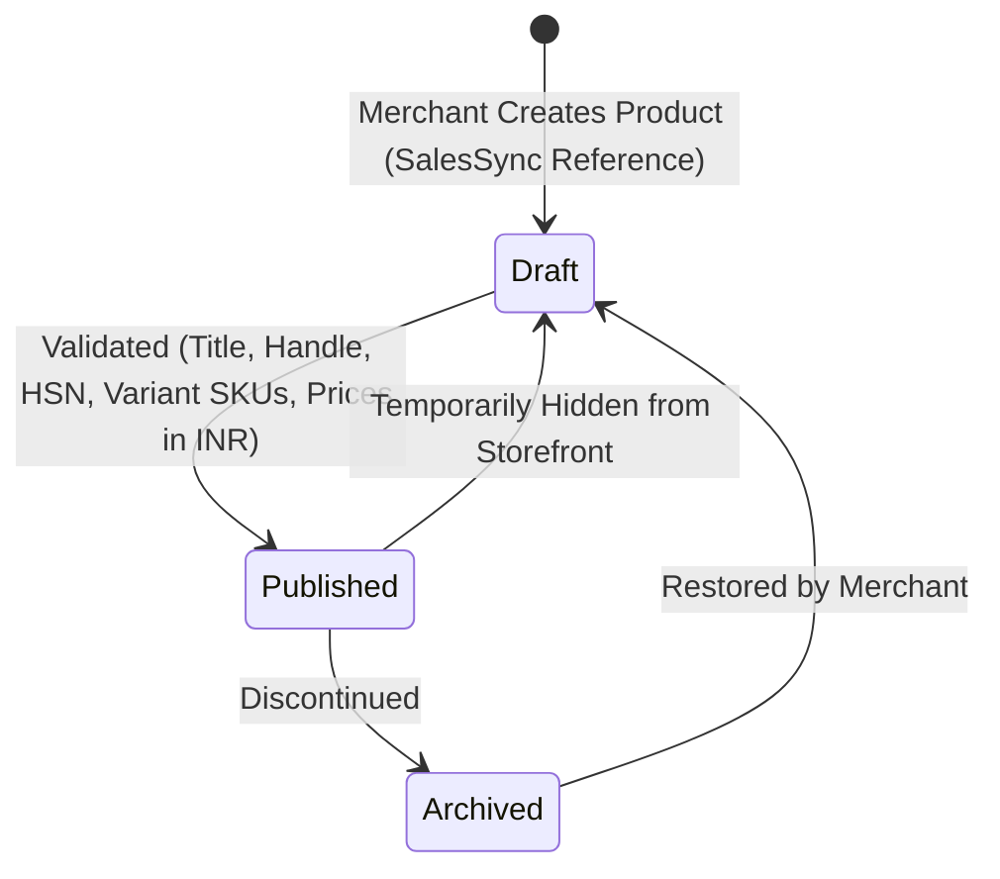
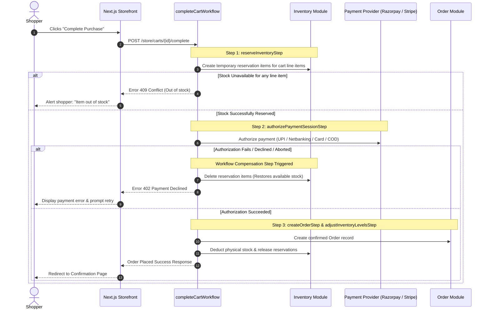
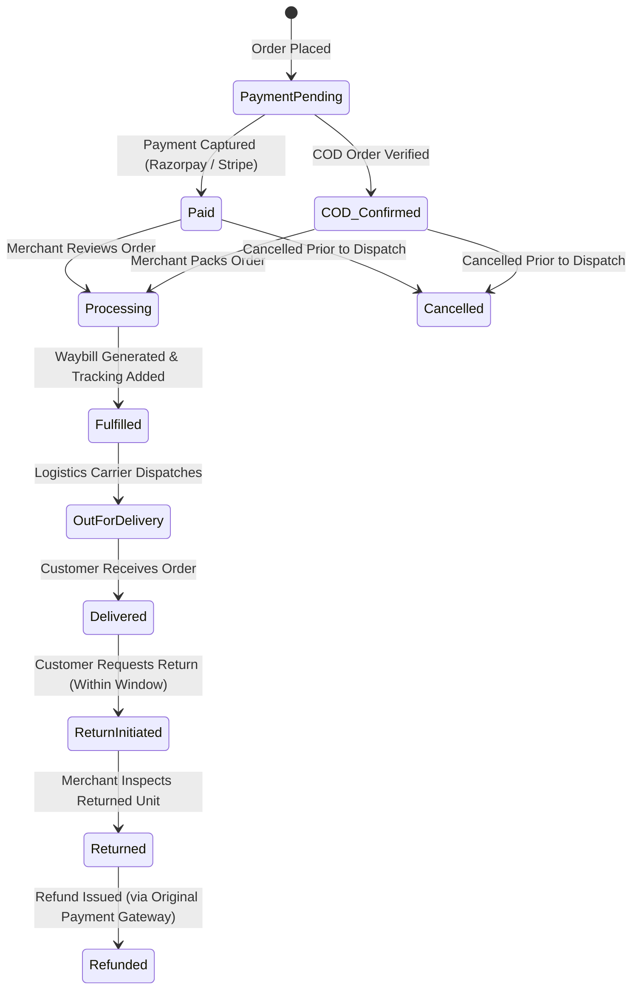

# Commerce Workflows & State Machines

**Project**: The Ecom Buddy  
**Document**: Commerce Workflows & State Machines Specification  
**Status**: Revised Architecture Specification (Post-Review Revision)  
**Milestone**: 01 (Foundation & Technical Specification)  
**Author**: Principal Software Architect & Senior E-commerce Product Engineer  

---

## 1. Executive Summary

This document specifies the business workflows, transactional state machines, and concurrency controls governing **The Ecom Buddy**. 

In strict adherence to **Medusa v2** standards, all core commerce operations (inventory reservation, checkout progression, payment authorization, and order completion) utilize Medusa's official **Workflows Engine** with durable execution and automated compensation. Custom logic that duplicates or bypasses Medusa's checkout engine has been removed.

---

## 2. Product & Variant Lifecycle Workflow (500+ Products Scale)

### 2.1 State Transitions & Scale Requirements
* **Catalog Capacity**: The catalog supports a minimum of **500 distinct products** per merchant. With multi-attribute variants (Size $\times$ Color $\times$ Material), typical merchant catalogs span **1,500 to 4,000+ distinct sellable SKUs**.
* **Product Status States**: `Draft`, `Published`, and `Archived`.
* **Variant Matrix Generation**: When a merchant creates options (e.g., Size: S, M, L $\times$ Color: Navy, Olive), the admin interface generates the full variant combination matrix.
* **SKU & Barcode Conventions**: Deterministic SKU generation formatted as:  
  `[PRODUCT-HANDLE]-[OPTION1-VALUE]-[OPTION2-VALUE]` (e.g., `LNN-SHIRT-NVY-M`).
* **HSN & Tax Classification**: Each product is assigned an Indian HSN (Harmonized System of Nomenclature) code (e.g., `6205` for Men's Shirts) to automate GST classification.

---

## 3. Inventory & Reservation Lifecycle (Official Medusa Workflows)

### 3.1 Eliminating Conflicting Custom Logic
Previous proposals for manual SQL row-level locks (`SELECT FOR UPDATE`) and custom cron workers have been replaced with Medusa v2's native **Inventory Module** and **`completeCartWorkflow`**.

### 3.2 Native Reservation & Compensation Workflow
During checkout, Medusa v2 orchestrates stock management through declarative workflow steps:

### 3.3 Concurrency & Overselling Prevention
* Medusa's `reserveInventoryStep` validates available inventory against `(stocked_quantity - reserved_quantity)`.
* Because reservation creation occurs in an atomic database transaction prior to payment authorization, multiple simultaneous checkout attempts for the last remaining unit cannot both succeed. The second transaction immediately receives an out-of-stock validation error.
* **Automatic Reservation Expiry**: Medusa's built-in reservation TTL automatically cleans up expired reservations if a shopper abandons an active checkout session without completing payment.

---

## 4. India-First Checkout & Payment Workflow

### 4.1 Four-Step Checkout Progression
1. **Step 1: Contact & Delivery Address (India-First)**
   * Mobile phone number (mandatory for Indian logistics SMS tracking) and Email address.
   * Delivery destination:
     * Full Name & Street Address.
     * Flat/Building No. & Landmark.
     * 6-digit **PIN Code** (with automated asynchronous lookup for City and State).
     * State/Union Territory dropdown (all 28 states & 8 UTs).
   * Optional: B2B Business Name and 15-character **GSTIN** for tax invoice credit.
2. **Step 2: Shipping Method Selection**
   * Real-time calculation based on delivery PIN code and destination zone:
     * *Local / Metro Express* (1–2 business days).
     * *Standard Surface (Rest of India)* (3–5 business days).
     * *Free Shipping* (automatically applied when order subtotal exceeds merchant threshold, e.g., ₹1,499).
3. **Step 3: GST Tax Calculation (CGST/SGST vs. IGST)**
   * The tax engine dynamically computes:
     * If customer State = merchant origin State $\rightarrow$ **CGST** (e.g., 6%) + **SGST** (e.g., 6%).
     * If customer State $\ne$ merchant origin State $\rightarrow$ **IGST** (e.g., 12%).
   * Displayed clearly before final payment authorization.
4. **Step 4: Payment Authorization**
   * **Razorpay**:
     * **UPI**: Instant QR code display on desktop; UPI Intent app switch (Google Pay, PhonePe, Paytm, CRED) on mobile.
     * **Netbanking**: Direct redirect across major Indian banks.
     * **Cards**: RuPay, Visa, Mastercard with mandatory 3D-Secure OTP verification.
   * **Cash on Delivery (COD)**:
     * Validated against merchant's PIN code whitelist.
     * Optional flat or tiered COD convenience fee (e.g., ₹50).
     * Optional phone verification OTP to reduce RTO (Return to Origin) rate.
   * **Stripe**: International card processing and Apple Pay for overseas customers.

### 4.2 Webhook Idempotency & Reconciliation
* **Idempotent Handlers**: All payment webhooks (`payment.captured`, `order.paid`, `payment.failed`) utilize Medusa's event handler idempotency guarantees. Webhooks verify the signature and ensure that an already-processed transaction is acknowledged with `200 OK` without triggering duplicate order creation.
* **Automated Reconciliation**: A background reconciliation routine polls pending payment sessions older than 30 minutes against Razorpay/Stripe APIs to capture any authorizations whose browser redirect was interrupted by mobile network drops.

---

## 5. Order Fulfillment, Returns & Refund Workflow

### 5.1 Merchant Fulfillment Actions
* **GST Tax Invoice & Packing Slip**: Non-technical merchants can generate a tax-compliant Indian GST invoice (PDF) in one click from the admin dashboard, displaying:
  * Merchant GSTIN, PAN, and registered address.
  * Customer billing address and optional customer GSTIN.
  * Itemized line items with HSN codes, taxable value, CGST/SGST/IGST rates, and amounts in INR (`₹`).
* **Logistics Tracking**: Merchant enters carrier name (e.g., Shiprocket, Delhivery, BlueDart) and Tracking Number/AWB. Automated transactional SMS and Email are dispatched to the customer.

### 5.2 Refund & Restock Automation
* When issuing refunds via the admin:
  * Merchant specifies refund amount (Full or Partial).
  * Checkbox: **"Restock returned items to inventory"** (default checked).
  * Medusa's official refund workflow automatically issues the credit via Razorpay/Stripe API and increments physical inventory atomically.
