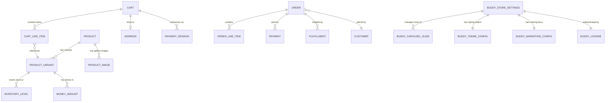

# Database Design & Schema Specification

**Project**: The Ecom Buddy  
**Document**: Database Design & Schema Specification  
**Status**: Approved for Architecture Review  
**Milestone**: 01 (Foundation & Technical Specification)  
**Author**: Principal Software Architect & Senior E-commerce Product Engineer  

---

## 1. Database Architecture & Engine Overview

The persistent data tier for **The Ecom Buddy** is built on **PostgreSQL 16**. PostgreSQL is selected for its robust transactional guarantees (`ACID`), native `JSONB` support for flexible custom attributes, row-level locking primitives (`SELECT ... FOR UPDATE`), and advanced indexing capabilities (GIN for full-text catalog search and JSONB indexing).



---

## 2. Core Commerce Tables (Medusa v2 Foundation)

### 2.1 Product & Catalog Entities

#### `products`
Stores top-level product records.
```sql
CREATE TABLE products (
    id VARCHAR(36) PRIMARY KEY,
    title VARCHAR(255) NOT NULL,
    subtitle TEXT,
    description TEXT,
    handle VARCHAR(255) UNIQUE NOT NULL,
    status VARCHAR(32) NOT NULL DEFAULT 'draft', -- draft, published, archived
    thumbnail TEXT,
    weight NUMERIC(10,2),
    length NUMERIC(10,2),
    height NUMERIC(10,2),
    width NUMERIC(10,2),
    hs_code VARCHAR(64),
    origin_country VARCHAR(2),
    metadata JSONB DEFAULT '{}',
    search_vector TSVECTOR,
    created_at TIMESTAMPTZ NOT NULL DEFAULT NOW(),
    updated_at TIMESTAMPTZ NOT NULL DEFAULT NOW(),
    deleted_at TIMESTAMPTZ
);

CREATE INDEX idx_products_handle ON products(handle);
CREATE INDEX idx_products_status ON products(status) WHERE deleted_at IS NULL;
CREATE INDEX idx_products_search ON products USING GIN(search_vector);
```

#### `product_variants`
Represents sellable SKUs associated with specific option combinations.
```sql
CREATE TABLE product_variants (
    id VARCHAR(36) PRIMARY KEY,
    product_id VARCHAR(36) NOT NULL REFERENCES products(id) ON DELETE CASCADE,
    title VARCHAR(255) NOT NULL,
    sku VARCHAR(128) UNIQUE NOT NULL,
    barcode VARCHAR(128),
    ean VARCHAR(128),
    upc VARCHAR(128),
    inventory_quantity INT NOT NULL DEFAULT 0,
    allow_backorder BOOLEAN NOT NULL DEFAULT FALSE,
    manage_inventory BOOLEAN NOT NULL DEFAULT TRUE,
    weight NUMERIC(10,2),
    metadata JSONB DEFAULT '{}',
    created_at TIMESTAMPTZ NOT NULL DEFAULT NOW(),
    updated_at TIMESTAMPTZ NOT NULL DEFAULT NOW(),
    deleted_at TIMESTAMPTZ
);

CREATE INDEX idx_variants_product_id ON product_variants(product_id);
CREATE INDEX idx_variants_sku ON product_variants(sku);
```

#### `product_options` & `product_option_values`
Defines variant attributes (e.g., Size, Color, Finish).
```sql
CREATE TABLE product_options (
    id VARCHAR(36) PRIMARY KEY,
    product_id VARCHAR(36) NOT NULL REFERENCES products(id) ON DELETE CASCADE,
    title VARCHAR(128) NOT NULL, -- e.g., 'Size', 'Color'
    metadata JSONB DEFAULT '{}',
    created_at TIMESTAMPTZ NOT NULL DEFAULT NOW()
);

CREATE TABLE product_option_values (
    id VARCHAR(36) PRIMARY KEY,
    option_id VARCHAR(36) NOT NULL REFERENCES product_options(id) ON DELETE CASCADE,
    variant_id VARCHAR(36) NOT NULL REFERENCES product_variants(id) ON DELETE CASCADE,
    value VARCHAR(128) NOT NULL, -- e.g., 'Medium', 'Navy'
    created_at TIMESTAMPTZ NOT NULL DEFAULT NOW()
);

CREATE UNIQUE INDEX uq_option_variant ON product_option_values(option_id, variant_id);
```

---

### 2.2 Inventory & Stock Reservations

#### `inventory_levels` & `inventory_reservations`
Supports multi-location stock tracking with concurrency locks.
```sql
CREATE TABLE inventory_levels (
    id VARCHAR(36) PRIMARY KEY,
    variant_id VARCHAR(36) NOT NULL REFERENCES product_variants(id) ON DELETE CASCADE,
    location_id VARCHAR(36) NOT NULL,
    stocked_quantity INT NOT NULL DEFAULT 0,
    reserved_quantity INT NOT NULL DEFAULT 0,
    incoming_quantity INT NOT NULL DEFAULT 0,
    updated_at TIMESTAMPTZ NOT NULL DEFAULT NOW(),
    CONSTRAINT chk_positive_stocked CHECK (stocked_quantity >= 0),
    CONSTRAINT chk_positive_reserved CHECK (reserved_quantity >= 0)
);

CREATE UNIQUE INDEX uq_variant_location ON inventory_levels(variant_id, location_id);

CREATE TABLE inventory_reservations (
    id VARCHAR(36) PRIMARY KEY,
    cart_id VARCHAR(36) NOT NULL,
    variant_id VARCHAR(36) NOT NULL REFERENCES product_variants(id) ON DELETE CASCADE,
    location_id VARCHAR(36) NOT NULL,
    quantity INT NOT NULL,
    expires_at TIMESTAMPTZ NOT NULL,
    created_at TIMESTAMPTZ NOT NULL DEFAULT NOW()
);

CREATE INDEX idx_reservations_expiry ON inventory_reservations(expires_at);
CREATE INDEX idx_reservations_cart ON inventory_reservations(cart_id);
```

---

### 2.3 Cart & Checkout Entities

#### `carts` & `cart_line_items`
```sql
CREATE TABLE carts (
    id VARCHAR(36) PRIMARY KEY,
    customer_id VARCHAR(36),
    email VARCHAR(255),
    billing_address_id VARCHAR(36),
    shipping_address_id VARCHAR(36),
    region_id VARCHAR(36) NOT NULL,
    currency_code VARCHAR(3) NOT NULL DEFAULT 'USD',
    subtotal INT NOT NULL DEFAULT 0, -- Stored in smallest currency unit (cents)
    discount_total INT NOT NULL DEFAULT 0,
    shipping_total INT NOT NULL DEFAULT 0,
    tax_total INT NOT NULL DEFAULT 0,
    total INT NOT NULL DEFAULT 0,
    coupon_code VARCHAR(64),
    completed_at TIMESTAMPTZ,
    created_at TIMESTAMPTZ NOT NULL DEFAULT NOW(),
    updated_at TIMESTAMPTZ NOT NULL DEFAULT NOW()
);

CREATE TABLE cart_line_items (
    id VARCHAR(36) PRIMARY KEY,
    cart_id VARCHAR(36) NOT NULL REFERENCES carts(id) ON DELETE CASCADE,
    variant_id VARCHAR(36) NOT NULL REFERENCES product_variants(id),
    title VARCHAR(255) NOT NULL,
    thumbnail TEXT,
    unit_price INT NOT NULL, -- Snapshotted unit price
    quantity INT NOT NULL,
    tax_rate NUMERIC(6,4) NOT NULL DEFAULT 0.0000,
    metadata JSONB DEFAULT '{}',
    created_at TIMESTAMPTZ NOT NULL DEFAULT NOW()
);

CREATE INDEX idx_line_items_cart ON cart_line_items(cart_id);
```

---

### 2.4 Order & Transaction Entities

#### `orders` & `order_line_items`
```sql
CREATE TABLE orders (
    id VARCHAR(36) PRIMARY KEY,
    display_id SERIAL, -- Human-readable Order # (e.g., 1001)
    status VARCHAR(32) NOT NULL DEFAULT 'pending', -- pending, completed, archived, cancelled
    fulfillment_status VARCHAR(32) NOT NULL DEFAULT 'not_fulfilled', -- not_fulfilled, partially_fulfilled, fulfilled, returned
    payment_status VARCHAR(32) NOT NULL DEFAULT 'awaiting', -- awaiting, captured, refunded, partially_refunded
    customer_id VARCHAR(36) NOT NULL,
    email VARCHAR(255) NOT NULL,
    currency_code VARCHAR(3) NOT NULL,
    total INT NOT NULL,
    subtotal INT NOT NULL,
    tax_total INT NOT NULL,
    shipping_total INT NOT NULL,
    discount_total INT NOT NULL,
    idempotency_key VARCHAR(128) UNIQUE,
    canceled_at TIMESTAMPTZ,
    created_at TIMESTAMPTZ NOT NULL DEFAULT NOW(),
    updated_at TIMESTAMPTZ NOT NULL DEFAULT NOW()
);

CREATE INDEX idx_orders_customer ON orders(customer_id);
CREATE INDEX idx_orders_status ON orders(status);
CREATE INDEX idx_orders_display_id ON orders(display_id);
```

---

## 3. The Ecom Buddy Custom Extension Tables

These tables are managed under the `@ecom-buddy/module-core` extension schema to isolate platform customizations from upstream commerce engine updates.

### 3.1 Storefront Customization: The 6-Slide Carousel

#### `buddy_carousel_slides`
Enforces the mandatory 6-slide homepage carousel with desktop and mobile asset pairing.
```sql
CREATE TABLE buddy_carousel_slides (
    id VARCHAR(36) PRIMARY KEY,
    slot_number INT NOT NULL CHECK (slot_number BETWEEN 1 AND 6),
    is_active BOOLEAN NOT NULL DEFAULT TRUE,
    title VARCHAR(255) NOT NULL,
    subtitle TEXT,
    image_desktop_url TEXT NOT NULL,
    image_mobile_url TEXT NOT NULL,
    cta_label VARCHAR(64) NOT NULL DEFAULT 'Shop Now',
    cta_link VARCHAR(255) NOT NULL DEFAULT '/collections/all',
    text_alignment VARCHAR(16) NOT NULL DEFAULT 'left', -- 'left', 'center', 'right'
    scrim_opacity NUMERIC(3,2) NOT NULL DEFAULT 0.30, -- Contrast overlay 0.00 to 1.00
    display_order INT NOT NULL DEFAULT 1,
    created_at TIMESTAMPTZ NOT NULL DEFAULT NOW(),
    updated_at TIMESTAMPTZ NOT NULL DEFAULT NOW(),
    CONSTRAINT uq_carousel_slot UNIQUE (slot_number)
);

CREATE INDEX idx_carousel_active_order ON buddy_carousel_slides(is_active, display_order);
```

---

### 3.2 Visual Branding & Design Tokens

#### `buddy_theme_config`
Allows non-technical merchants to customize their storefront colors, typography, and announcement bar without editing CSS files.
```sql
CREATE TABLE buddy_theme_config (
    id VARCHAR(36) PRIMARY KEY,
    brand_name VARCHAR(128) NOT NULL,
    logo_url TEXT,
    favicon_url TEXT,
    primary_color VARCHAR(10) NOT NULL DEFAULT '#18181B', -- Hex color
    accent_color VARCHAR(10) NOT NULL DEFAULT '#D97706',  -- Warm editorial accent
    surface_color VARCHAR(10) NOT NULL DEFAULT '#FAFAFA', -- Surface background
    typography_preset VARCHAR(64) NOT NULL DEFAULT 'editorial-serif-sans', -- Preset pairing
    announcement_enabled BOOLEAN NOT NULL DEFAULT TRUE,
    announcement_text VARCHAR(255) DEFAULT 'Complimentary domestic express shipping on orders over $150',
    announcement_link VARCHAR(255) DEFAULT '/collections/new-arrivals',
    announcement_bg_color VARCHAR(10) NOT NULL DEFAULT '#18181B',
    announcement_text_color VARCHAR(10) NOT NULL DEFAULT '#FFFFFF',
    updated_at TIMESTAMPTZ NOT NULL DEFAULT NOW()
);
```

---

### 3.3 Marketing & Telemetry Integration

#### `buddy_marketing_config`
Secures all credentials required for Meta Pixel, Meta Conversions API (CAPI), Google Analytics 4, and Google Tag Manager.
```sql
CREATE TABLE buddy_marketing_config (
    id VARCHAR(36) PRIMARY KEY,
    meta_pixel_id VARCHAR(64),
    meta_capi_token TEXT, -- Server-side access token (AES encrypted)
    meta_test_event_code VARCHAR(64), -- For Meta Realtime Events Testing
    ga_measurement_id VARCHAR(64), -- e.g., 'G-XXXXXXXXXX'
    ga_api_secret TEXT, -- Measurement Protocol API secret (AES encrypted)
    gtm_container_id VARCHAR(64), -- e.g., 'GTM-XXXXXXX'
    is_meta_enabled BOOLEAN NOT NULL DEFAULT FALSE,
    is_ga_enabled BOOLEAN NOT NULL DEFAULT FALSE,
    is_gtm_enabled BOOLEAN NOT NULL DEFAULT FALSE,
    consent_mode_default VARCHAR(16) NOT NULL DEFAULT 'granted', -- 'denied' or 'granted'
    updated_at TIMESTAMPTZ NOT NULL DEFAULT NOW()
);
```

---

### 3.4 Software Licensing & White-Label Activation

#### `buddy_license`
Validates the one-time software license for independent deployments without relying on a central SaaS kill-switch.
```sql
CREATE TABLE buddy_license (
    id VARCHAR(36) PRIMARY KEY,
    license_key VARCHAR(128) UNIQUE NOT NULL,
    client_name VARCHAR(255) NOT NULL,
    authorized_domain VARCHAR(255) NOT NULL,
    digital_signature TEXT NOT NULL, -- Ed25519 signature
    activated_at TIMESTAMPTZ NOT NULL DEFAULT NOW(),
    last_verified_at TIMESTAMPTZ NOT NULL DEFAULT NOW(),
    license_status VARCHAR(32) NOT NULL DEFAULT 'active', -- active, invalid, suspended
    edition VARCHAR(32) NOT NULL DEFAULT 'commercial_lifetime',
    white_label_enabled BOOLEAN NOT NULL DEFAULT TRUE
);
```

---

## 4. Indexing & Concurrency Controls

### 4.1 Full-Text Catalog Search
To support instant product searches across 500+ SKUs with zero external dependencies (no Elasticsearch required):
```sql
-- Trigger to maintain search_vector automatically on title/description change
CREATE OR REPLACE FUNCTION products_search_vector_trigger() RETURNS trigger AS $$
BEGIN
    NEW.search_vector :=
        setweight(to_tsvector('english', coalesce(NEW.title, '')), 'A') ||
        setweight(to_tsvector('english', coalesce(NEW.subtitle, '')), 'B') ||
        setweight(to_tsvector('english', coalesce(NEW.description, '')), 'C');
    RETURN NEW;
END
$$ LANGUAGE plpgsql;

CREATE TRIGGER trg_products_search_update
    BEFORE INSERT OR UPDATE ON products
    FOR EACH ROW EXECUTE FUNCTION products_search_vector_trigger();
```

### 4.2 Concurrency & Transaction Isolation
* All inventory reservation queries use `SELECT ... FOR UPDATE` inside `READ COMMITTED` transactions to guarantee serialization on individual SKU stock levels.
* Deadlock prevention is guaranteed by sorting requested variant IDs alphabetically before acquiring locks in batch checkout transactions.
