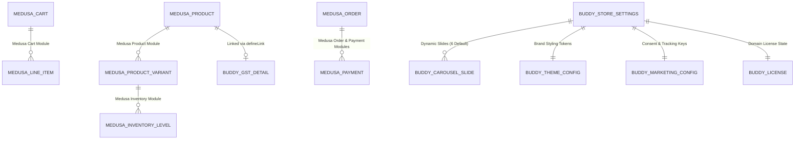

# Database Design & Schema Specification

**Project**: The Ecom Buddy  
**Document**: Database Design & Schema Specification  
**Status**: Revised Architecture Specification (Post-Review Revision)  
**Milestone**: 01 (Foundation & Technical Specification)  
**Author**: Principal Software Architect & Senior E-commerce Product Engineer  

---

## 1. Database Architecture & Schema Ownership

The data tier is powered by **PostgreSQL 16**. Under our architectural philosophy, **Medusa v2 owns and manages all core commerce tables** through its official modules and CLI migrations (`medusa db:migrate`). 

The Ecom Buddy does **not** create manual DDL tables for core commerce entities (products, variants, inventory, carts, orders, or payments). Custom platform requirements are defined using Medusa's official **Data Modeling Layer (DML)** and **Module Links**, which generate and manage database migrations automatically.



---

## 2. Core Medusa v2 Modules & Schema Responsibilities

Core commerce schemas are provisioned and upgraded strictly via Medusa v2:

| Medusa Core Module | Governed Entities | Migration Authority |
| :--- | :--- | :--- |
| `@medusajs/medusa/product` | `product`, `product_variant`, `product_option`, `product_option_value`, `product_category`, `product_collection`, `product_tag` | Official Medusa Migrations |
| `@medusajs/medusa/inventory` | `inventory_item`, `inventory_level`, `reservation_item` | Official Medusa Migrations |
| `@medusajs/medusa/pricing` | `price_set`, `price_list`, `price` (Multi-currency support: INR default, USD, EUR) | Official Medusa Migrations |
| `@medusajs/medusa/cart` | `cart`, `line_item`, `address`, `shipping_method` | Official Medusa Migrations |
| `@medusajs/medusa/order` | `order`, `order_item`, `order_change`, `order_summary` | Official Medusa Migrations |
| `@medusajs/medusa/payment` | `payment_collection`, `payment_session`, `payment`, `refund` | Official Medusa Migrations |
| `@medusajs/medusa/tax` | `tax_region`, `tax_rate`, `tax_rate_rule` | Official Medusa Migrations |

---

## 3. The Ecom Buddy Custom DML Modules (`src/modules/*`)

Custom requirements are modeled declaratively using Medusa v2's DML (`model.define`), ensuring complete compatibility with Medusa migrations, service containers, and GraphQL/REST endpoints.

### 3.1 Store Customizer Module: Dynamic Hero Carousel

#### Carousel Slide Model (`src/modules/store-customizer/models/carousel-slide.ts`)
* **Six Default Configured Slides**: Pre-seeded during initialization to provide an out-of-the-box editorial storefront.
* **Unconstrained Slide Capacity**: Merchants are **not limited** to six slides. They can add, edit, disable, reorder, and remove slides dynamically. The previous SQL check constraint (`CHECK slot BETWEEN 1 AND 6`) has been completely removed.

```typescript
import { model } from "@medusajs/framework/utils";

export const CarouselSlide = model.define("carousel_slide", {
  id: model.id().primaryKey(),
  is_active: model.boolean().default(true),
  display_order: model.number().default(1),
  title: model.text(),
  subtitle: model.text().nullable(),
  image_desktop_url: model.text(),
  image_mobile_url: model.text(),
  cta_label: model.text().default("Shop Now"),
  cta_link: model.text().default("/collections/all"),
  text_alignment: model.enum(["left", "center", "right"]).default("left"),
  scrim_opacity: model.number().default(0.30),
});
```

#### Theme Configuration Model (`src/modules/store-customizer/models/theme-config.ts`)
Allows non-technical merchants to modify their visual identity without touching code:

```typescript
export const ThemeConfig = model.define("theme_config", {
  id: model.id().primaryKey(),
  brand_name: model.text(),
  logo_url: model.text().nullable(),
  favicon_url: model.text().nullable(),
  primary_color: model.text().default("#18181B"),
  accent_color: model.text().default("#C28E5C"),
  surface_color: model.text().default("#FAFAFA"),
  typography_preset: model.text().default("editorial-serif-sans"),
  announcement_enabled: model.boolean().default(true),
  announcement_text: model.text().default("Complimentary express shipping on orders over ₹1,499"),
  announcement_link: model.text().default("/collections/all"),
  announcement_bg_color: model.text().default("#18181B"),
  announcement_text_color: model.text().default("#FFFFFF"),
});
```

---

### 3.2 Marketing & Telemetry Module

#### Marketing Configuration Model (`src/modules/marketing/models/marketing-config.ts`)
Stores encrypted credentials for Meta and Google tracking. To eliminate previous privacy contradictions, **consent defaults to `'denied'`** until explicit shopper opt-in:

```typescript
export const MarketingConfig = model.define("marketing_config", {
  id: model.id().primaryKey(),
  meta_pixel_id: model.text().nullable(),
  meta_capi_token: model.text().nullable(), // Encrypted at rest (AES-256)
  meta_test_event_code: model.text().nullable(),
  ga_measurement_id: model.text().nullable(),
  ga_api_secret: model.text().nullable(), // Encrypted at rest (AES-256)
  gtm_container_id: model.text().nullable(),
  is_meta_enabled: model.boolean().default(false),
  is_ga_enabled: model.boolean().default(false),
  is_gtm_enabled: model.boolean().default(false),
  default_consent_mode: model.enum(["denied", "granted"]).default("denied"), // Privacy-first default
});
```

---

### 3.3 India-First GST & Tax Module Extension

#### GST Product Details Model (`src/modules/india-tax/models/gst-product-detail.ts`)
Links HSN codes and GST rates to Medusa's core `Product` model via official module links:

```typescript
export const GstProductDetail = model.define("gst_product_detail", {
  id: model.id().primaryKey(),
  hsn_code: model.text(), // e.g., '6205'
  gst_rate: model.number().default(12.00), // GST percentage (e.g., 5%, 12%, 18%, 28%)
  tax_inclusive: model.boolean().default(true),
});
```

#### Module Link Definition (`src/links/product-gst.ts`)
```typescript
import { defineLink } from "@medusajs/framework/utils";
import ProductModule from "@medusajs/medusa/product";
import IndiaTaxModule from "../modules/india-tax";

export default defineLink(
  ProductModule.linkable.product,
  IndiaTaxModule.linkable.gstProductDetail
);
```

---

### 3.4 Software Licensing & White-Label Module

#### License Record Model (`src/modules/licensing/models/license-record.ts`)
```typescript
export const LicenseRecord = model.define("license_record", {
  id: model.id().primaryKey(),
  license_key: model.text().unique(),
  client_name: model.text(),
  authorized_domain: model.text(),
  digital_signature: model.text(), // Ed25519 cryptographic signature
  activated_at: model.dateTime(),
  last_verified_at: model.dateTime(),
  license_status: model.enum(["active", "invalid", "suspended"]).default("active"),
  edition: model.text().default("commercial_lifetime"),
  white_label_enabled: model.boolean().default(true),
});
```

---

## 4. Catalog Scalability & Query Performance (500+ Products)

To ensure sub-100ms response times across 500+ distinct products (and 1,500–4,000+ SKUs):

### 4.1 Indexing Strategy
* **Covering Compound Indexes**: Medusa's database migrations maintain B-tree compound indexes on `(product_id, deleted_at)` and `(sku, deleted_at)`.
* **Full-Text Search Indexing**: PostgreSQL `tsvector` indexes on product title, handle, subtitle, and tags ensure instant search and filtering without external search engine overhead.
* **Pagination & Memory Safeguards**: All catalog queries from Next.js 15 utilize cursor-based or limit/offset pagination (default 24 products per page) to prevent excessive memory consumption during high-traffic browsing.
