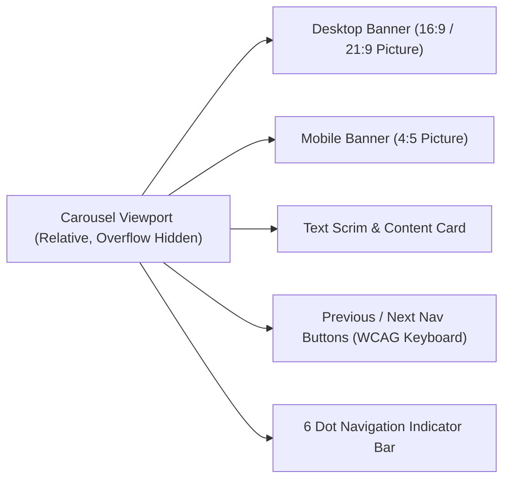

# Design System & UI Specification Plan

**Project**: The Ecom Buddy  
**Document**: Design System & UI Specification Plan  
**Status**: Approved for Architecture Review  
**Milestone**: 01 (Foundation & Technical Specification)  
**Author**: Principal Software Architect & Senior E-commerce Product Engineer  

---

## 1. Design Direction & Visual Authority

### 1.1 The Seven Visual Reference Screenshots
The forthcoming frontend implementation across **The Ecom Buddy** is strictly governed by the seven design reference screenshots located in `/design-references`. 

These references represent a **high-end, editorial, conversion-focused e-commerce aesthetic** characterized by authentic photography, purposeful whitespace, refined typography, and tactile interface details.

| Screenshot Identifier | Scope | Primary Visual & UX Deliverable |
| :--- | :--- | :--- |
| `01-storefront-hero-carousel` | Storefront Homepage | Curated 6-slide carousel with desktop/mobile focal point pairing, elegant typography overlay, and transparent-to-solid navigation header. |
| `02-curated-product-grid` | Catalog & Collections | Asymmetric and structured grid rhythms, category pills, subtle hover elevation, secondary image flip, and instant quick-view drawers. |
| `03-product-detail-page` | Product Page (PDP) | Multi-angle image gallery, tactile variant selectors (color swatches & size pills), sticky buy-box on mobile, accordion specs, and social proof. |
| `04-cart-and-mini-cart` | Cart Drawer | Slide-over mini-cart with dynamic Free Shipping progress bar, inline quantity steppers, item deletion feedback, and sticky checkout button. |
| `05-checkout-experience` | Checkout Flow | Distraction-free single-page checkout, collapsible order summary, express payment buttons (Apple Pay/Google Pay), and trust indicators. |
| `06-merchant-admin-catalog` | Merchant Dashboard | High-density data table managing 500+ SKUs, batch inventory adjustments, low-stock visual badges, and variant matrix generator. |
| `07-storefront-customizer` | Merchant Customizer | No-code visual editor for the 6 carousel slides, branding color tokens, typography pairings, and marketing API integrations. |

### 1.2 Strict Prohibitions
To preserve commercial authenticity and avoid low-quality automated aesthetics, future frontend implementation is bound by the following prohibitions:
* **No Generic "AI Aesthetics"**: Zero purple-to-teal neon gradients, no arbitrary geometric blobs, and no ungrounded decorative glowing cards.
* **No AI-Generated Doodles or Illustrations**: Use authentic product photography and crisp, standardized SVG iconography (Lucide / Radix Icons).
* **No Monotonous Template Layouts**: Avoid repetitive 4-column equal-height card grids with zero editorial hierarchy.
* **No UI Implementation in Milestone 01**: Milestone 01 establishes specifications and tokens only. Code implementation commences in Milestone 02/04.

---

## 2. Design Tokens Architecture (Tailwind CSS v4 & CSS Variables)

Design tokens are expressed as semantic CSS custom variables mapped into Tailwind CSS, ensuring theme customization is clean, performant, and controllable via the merchant dashboard without rebuilding CSS stylesheets.

### 2.1 Color Tokens
```css
:root {
  /* Surface & Background */
  --surface-base: #FFFFFF;
  --surface-subtle: #F9FAFB;
  --surface-muted: #F3F4F6;
  --surface-inverted: #111827;

  /* Typography & Foreground */
  --text-primary: #111827;
  --text-secondary: #4B5563;
  --text-muted: #9CA3AF;
  --text-inverted: #FFFFFF;

  /* Brand & Accents (Customizable by Merchant) */
  --brand-primary: #18181B;     /* Default: Deep Architectural Zinc */
  --brand-primary-hover: #27272A;
  --brand-accent: #C28E5C;      /* Default: Editorial Warm Amber / Tan */
  --brand-accent-hover: #A67545;

  /* Borders & Dividers */
  --border-subtle: #E5E7EB;
  --border-strong: #D1D5DB;

  /* Semantic Feedback */
  --feedback-success: #15803D;
  --feedback-warning: #B45309;
  --feedback-destructive: #B91C1C;
  --feedback-info: #1D4ED8;
}
```

### 2.2 Typography System
The typography architecture pairs an **editorial serif for display headings** with a **crisp, modernist sans-serif for UI, metadata, and reading text**:

| Role | Font Family | Weights | Intended Use |
| :--- | :--- | :--- | :--- |
| **Display / Editorial** | *Instrument Serif* / *Playfair Display* | 400, 400 Italic | Hero carousel headlines, collection titles, product display titles |
| **Body / Interface** | *Plus Jakarta Sans* / *Inter* | 400, 500, 600, 700 | Navigation links, body copy, variant buttons, form labels |
| **Tabular / Monospace** | *JetBrains Mono* / *Geist Mono* | 500, 600 | Pricing displays, inventory SKU numbers, order IDs, tracking codes |

### 2.3 Elevation, Borders & Tactile Radius
* **Border Radii**: Controlled micro-radii to maintain an architectural, high-end feel:
  * Buttons & Form Inputs: `4px` or `6px` (`rounded-sm` / `rounded-md`).
  * Product Cards & Dialogs: `8px` (`rounded-lg`).
  * Variant Selection Pills: `9999px` (`rounded-full`).
* **Borders**: Sharp `1px` borders (`border border-subtle`) replace heavy dropshadows, ensuring high contrast on all displays.
* **Shadows**: Minimal elevation layers reserved strictly for interactive overlays (drawers, modals, dropdowns).

---

## 3. Core Storefront Component Specifications

### 3.1 The Six-Slide Homepage Carousel Component



#### Technical Specifications:
* **Capacity**: Fixed maximum of exactly 6 slots managed via merchant dashboard.
* **Responsive Image Serving**: Employs `<picture>` tag serving distinct desktop (`image_desktop_url`) and mobile (`image_mobile_url`) assets to eliminate awkward cropping on smartphones.
* **Performance / LCP**:
  * Slide 1 asset includes `priority={true}` and `fetchpriority="high"`.
  * Slides 2–6 utilize lazy loading with low-priority fetch.
* **Interaction & Accessibility**:
  * Touch swipe gestures with velocity inertia on mobile.
  * Pause auto-advance on mouse hover or keyboard focus.
  * Screen-reader announcements via `aria-roledescription="carousel"` and `aria-live="polite"`.

---

### 3.2 Product Card Component
* **Aspect Ratio**: Fixed `4:5` or `1:1` container preventing cumulative layout shift (CLS).
* **Hover State**: Seamless fade-in to secondary lifestyle photograph on desktop cursor hover.
* **Inventory Badge**: Discrete pills indicating *"Low Stock (Only 2 Left)"* or *"Pre-Order"*.
* **Variant Quick-Preview**: Mini color swatch dots reflecting in-stock colorways without navigating away from the grid.

---

### 3.3 Product Detail Page (PDP) Interactive Architecture
* **Media Gallery**:
  * Desktop: Dual-column sticky layout with vertical thumbnail strip and high-resolution main viewport with click-to-zoom.
  * Mobile: Horizontal swipe carousel with counter indicator (e.g., `2 / 5`).
* **Variant Selectors**:
  * Colors: Circular swatches with visual checkmark indicator and tooltip color name.
  * Sizes: Rectangular tactile pills; out-of-stock sizes rendered with a diagonal strikethrough line and disabled attribute.
* **Sticky Mobile Buy-Box**:
  * When the user scrolls past the main "Add to Cart" button on mobile devices, a compact sticky bar slides up from the bottom with thumbnail, price, variant summary, and one-tap purchase button.

---

### 3.4 Slide-Over Mini-Cart Drawer
* **Motion**: Smooth slide-in from right edge (`cubic-bezier(0.16, 1, 0.3, 1)`) with backdrop blur.
* **Free Shipping Tier Indicator**:
  * Dynamic calculation bar: `(subtotal / threshold) * 100%`.
  * Contextual copy: *"Add $18.50 more to unlock Free Standard Shipping"* $\rightarrow$ *"Congratulations! You have unlocked Free Shipping"*.
* **Optimistic Updates**: Changing quantity increments or decrements immediately in the UI using React 19 `useOptimistic` while the server mutation resolves in the background.

---

### 3.5 Frictionless One-Page Checkout
* **Visual Simplicity**: Distraction-free layout removing primary header navigation, footer links, and promotional banners.
* **Summary Sidebar**: Sticky order summary on desktop; collapsible accordion on mobile.
* **Security & Trust Signals**: Padlock icon, SSL encryption badge, and accepted payment method logos (Visa, Mastercard, Amex, Apple Pay, Google Pay).

---

## 4. Merchant Admin Component Specifications

### 4.1 500+ SKU Data Table
* **Density**: High-density table layout optimized for administrative speed.
* **Features**:
  * Virtualized scrolling or fast server-side pagination (25, 50, 100 rows per page).
  * Instant search filtering across product titles and SKU codes.
  * Inline stock editing with immediate optimistic save.
  * Bulk action toolbar: *Bulk Price Adjustment*, *Bulk Publish/Draft*, *Export to CSV*.

### 4.2 The 6-Slide Carousel Manager (Storefront Customizer)
* Visual accordion interface with 6 numbered slide cards.
* Drag-and-drop vertical reordering.
* Dual file drop-zones per slide: *Desktop Banner (1920x1080)* and *Mobile Banner (1080x1350)* with instant preview and focal point cropper.
* Live preview viewport toggle (Desktop / Mobile view) rendering changes in real time.

---

## 5. Accessibility & Quality Standards (WCAG 2.1 AA)

1. **Color Contrast**: All text-to-background contrast ratios strictly meet or exceed `4.5:1` for normal body copy and `3:1` for large display headings.
2. **Keyboard Navigability**: Every interactive component (carousel buttons, variant pills, cart drawer, checkout inputs) is fully operable via `Tab`, `Space`, `Enter`, and `Escape` keys with prominent focus rings (`focus-visible:ring-2`).
3. **Screen Reader Semantic Hierarchy**: Strict single `h1` per page, nested `h2`/`h3` headings, descriptive `alt` tags on all product media, and ARIA live regions for cart count updates.
4. **Reduced Motion**: Full support for `prefers-reduced-motion: reduce`, gracefully replacing slide animations with instant cuts.
