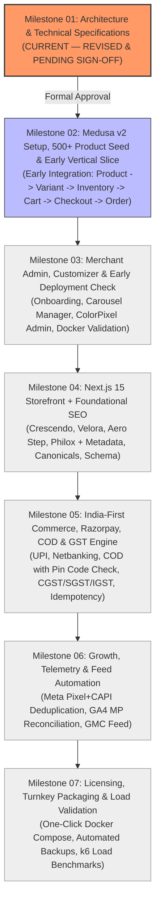

# Engineering Roadmap & Milestone Verification Plan

**Project**: The Ecom Buddy  
**Document**: Development Roadmap & Quality Gates  
**Status**: Revised Architecture Specification (Post-Review Revision)  
**Milestone**: 01 (Foundation & Technical Specification)  
**Author**: Principal Software Architect & Senior E-commerce Product Engineer  

---

## 1. Phased Execution Overview

The engineering execution plan is partitioned into **seven sequential milestones**. The revised roadmap incorporates three critical architectural enhancements:
1. **Early Vertical-Slice Testing** in Milestone 02: Testing `product -> variant -> inventory -> cart -> checkout -> order` directly through Medusa v2 workflows before building frontend UI.
2. **Early Deployment Validation** in Milestone 03: Testing Docker Compose builds and database persistence early rather than discovering environment issues at the end.
3. **Foundational SEO during Storefront Build** in Milestone 04: Integrating metadata, canonicals, and structured data alongside Next.js 15 UI implementation.

---

## 2. Detailed Milestone Specifications

### Milestone 01: Architecture Foundations & Technical Specifications (Current)
* **Scope**: Complete revision of all seven architecture specifications in `/docs` addressing all review criteria (Medusa data ownership, India-first setup, unconstrained dynamic carousel, consent-gated telemetry, measurable NFR targets, authoritative design reference mapping).
* **Deliverable**: `docs/ARCHITECTURE_REVIEW_CHANGES.md` and updated specifications.
* **Quality Gate**: Architecture review sign-off. Zero UI code generated.

---

### Milestone 02: Engine Setup, 500+ Seed Generator & Early Vertical-Slice Test
* **Prerequisites**: Approval of Milestone 01.
* **Scope**:
  * Initialize monorepo workspace (`apps/backend`, `apps/storefront`, `packages/*`).
  * Initialize Medusa v2 core engine with PostgreSQL 16 and Redis 7.
  * Implement `@ecom-buddy/module-core` custom DML modules (`carousel_slide`, `theme_config`, `marketing_config`, `gst_product_detail`).
  * **Automated Seed Generator**: Generates at least **500 distinct products** with multi-attribute variants (yielding 1,500–4,000+ SKUs), realistic INR pricing (`₹`), HSN codes, categories, and image galleries.
  * **Early Vertical-Slice Integration Test**: An automated end-to-end integration test executing:
    $$\text{Create Product} \rightarrow \text{Generate Variants} \rightarrow \text{Set Inventory} \rightarrow \text{Add to Cart} \rightarrow \text{Reserve Stock} \rightarrow \text{Authorize Payment} \rightarrow \text{Create Order}$$
    Testing built-in Medusa workflow compensations on payment failure.
* **Quality Gate**: Vertical slice test passes 100%; seed generator populates 500+ products cleanly; database query benchmarks execute under 100ms.

---

### Milestone 03: Merchant Admin Dashboard & Early Deployment Validation
* **Prerequisites**: Completion of Milestone 02.
* **Scope**:
  * Build Merchant Onboarding Wizard (**Reference 01: Merchant onboarding reference**).
  * Build High-Density Catalog Management (**Reference 06: ColorPixel merchant dashboard**).
  * Build Variant Matrix & HSN Creator (**Reference 07: SalesSync product creation interface**).
  * Build Dynamic Carousel Slide Customizer (pre-seeded with 6 default slides, full add/edit/reorder controls).
  * **Early Deployment Validation**: Build Docker images for backend and database; validate container startup, persistent volume mounting, and database migrations on a clean test environment.
* **Quality Gate**: Non-technical merchant can create products, adjust stock, and edit carousel slides via admin UI; Docker container boots and migrates cleanly.

---

### Milestone 04: Next.js 15 Storefront Implementation + Foundational SEO
* **Prerequisites**: Completion of Milestone 03 and visual confirmation of screenshots in `/design-references`.
* **Scope**:
  * Homepage Hero Carousel & Discovery (**Reference 02: Crescendo homepage**).
  * High-Conversion Product Detail Page (**Reference 03: Velora product details**).
  * Curated Collections & Storytelling (**Reference 04: Aero Step editorial storefront**).
  * Promotional Features & Banners (**Reference 05: Philox promotional layout**).
  * Slide-over Mini-Cart with dynamic Free Shipping progress bar.
  * **Foundational SEO Architecture**:
    * Dynamic metadata generation (`generateMetadata`) across products, categories, and static pages.
    * Strict canonical URL enforcement and filter/sort handling.
    * Schema.org JSON-LD structured data (`Product`, `Offer`, `BreadcrumbList`).
    * Dynamic `robots.txt` and XML sitemaps (`/sitemap.xml`).
* **Quality Gate**: Mobile & Desktop Google Lighthouse score $\ge 90$; visual fidelity aligned with reference screenshots.

---

### Milestone 05: India-First Commerce, Razorpay, COD & Tax Engine
* **Prerequisites**: Completion of Milestone 04.
* **Scope**:
  * Frictionless one-page checkout with Indian PIN code auto-fill for city/state.
  * Razorpay payment gateway integration (UPI Intent/QR, Netbanking, Cards).
  * Cash on Delivery (COD) engine with PIN code availability check and optional fee.
  * Indian GST calculation engine (CGST+SGST vs. IGST split based on merchant and customer state).
  * B2B GSTIN collection and one-click GST-compliant tax invoice PDF generation.
  * Webhook idempotency and payment reconciliation workflows.
* **Quality Gate**: Automated test suite executing successful UPI/Card/COD orders, verifying correct GST split and inventory deduction.

---

### Milestone 06: Marketing, Telemetry & Feed Automation
* **Prerequisites**: Completion of Milestone 05.
* **Scope**:
  * Dual-layer Meta tracking: browser pixel + server CAPI with stable entity-derived `event_id` and SHA-256 customer data hashing.
  * Google Analytics 4 dataLayer pushes + Measurement Protocol backend validation.
  * Google Consent Mode v2 implementation (default `denied`, dynamically updated on shopper opt-in).
  * Automated Google Merchant Center product feed (`/feeds/google-merchant-center.xml`).
* **Quality Gate**: Meta Test Event tool verifies receipt of client and server events with Event Match Quality $\ge 8.0/10$; GA4 DebugView confirms accurate event deduplication.

---

### Milestone 07: Licensing, Turnkey Packaging & Load Validation
* **Prerequisites**: Completion of Milestone 06.
* **Scope**:
  * Offline-capable domain-bound cryptographic license validation (Ed25519).
  * Production Docker Compose configuration with Caddy automated TLS 1.3 reverse proxy.
  * Automated daily backup and disaster recovery scripts (`backup.sh`, `restore.sh`).
  * **Performance & Load Testing**: Execute **k6** load testing simulating 50 concurrent active shopper sessions; validate p95 response time $\le 300\text{ ms}$.
  * Author non-technical merchant documentation.
* **Quality Gate**: Turnkey deployment on fresh Ubuntu Linux VPS completes in under 15 minutes with automated SSL; k6 load test passes performance targets.

---

## 3. Strict Milestone Gatekeeper Policy

> [!IMPORTANT]
> **Approval Gate**: Development on Milestone 02 will not commence until the revised architectural blueprints and the review changes document (`docs/ARCHITECTURE_REVIEW_CHANGES.md`) have been approved.
