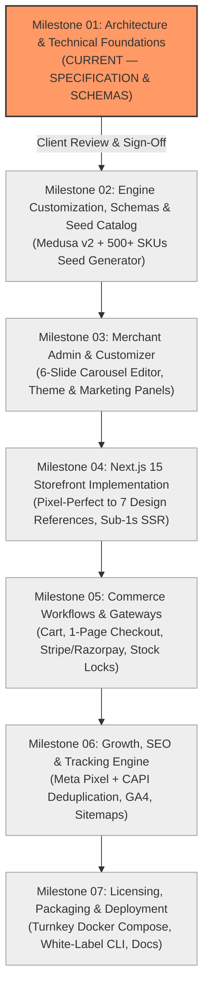

# Engineering Roadmap & Milestone Verification Plan

**Project**: The Ecom Buddy  
**Document**: Development Roadmap & Quality Gates  
**Status**: Approved for Architecture Review  
**Milestone**: 01 (Foundation & Technical Specification)  
**Author**: Principal Software Architect & Senior E-commerce Product Engineer  

---

## 1. Roadmap Overview & Phased Execution

To deliver a premium, production-grade white-label e-commerce platform with zero technical debt, engineering execution is structured into **seven sequential milestones**. Each milestone has rigorous quality gates and deliverables that must be verified before proceeding to the next phase.

---

## 2. Milestone Breakdown & Deliverables

### Milestone 01: Architecture, Data Schemas & Workflows (Current Milestone)
* **Status**: Complete & Pending Review.
* **Scope**:
  * Comprehensive requirements analysis for one-time software license model.
  * Technical architecture selection (Medusa v2 + Next.js 15 App Router + PostgreSQL 16 + Redis 7 + Caddy).
  * Commerce state machines and concurrency-safe inventory workflows.
  * Complete relational database schema with custom extension tables (`buddy_*`).
  * Dual-layer Meta Pixel + CAPI and GA4 tracking specifications.
  * Design system plan aligning with the seven visual reference screenshots.
  * Repository structure initialization and Git tracking.
* **Quality Gate**: Review of all seven technical specifications in `/docs`. Zero UI code or mock pages created during this phase.

---

### Milestone 02: Monorepo Setup, Engine Customization & Seed Catalog
* **Prerequisites**: Approval of Milestone 01.
* **Scope**:
  * Monorepo workspace configuration (`apps/backend`, `apps/storefront`, `packages/types`, `packages/ui`).
  * Initialize Medusa v2 core engine and database connection.
  * Implement `@ecom-buddy/module-core` extending DML models for carousel slides, theme config, marketing credentials, and license state.
  * Create high-performance database seed script generating realistic, premium catalog data across **500+ products** with multi-level variants, categories, images, and prices.
* **Quality Gate**: Automated database migration runs cleanly; seed script populates 500+ SKUs; GraphQL/REST queries respond under 50ms locally.

---

### Milestone 03: Merchant Admin Dashboard & Customizer
* **Prerequisites**: Completion of Milestone 02.
* **Scope**:
  * Customize embedded Medusa Admin with The Ecom Buddy white-label styling.
  * Build the **6-Slide Homepage Carousel Manager** with drag-and-drop ordering, desktop/mobile image uploaders, and live preview.
  * Build the **Theme & Brand Token Customizer** (color pickers, font pairing selector, announcement bar controls).
  * Build the **Marketing & Tracking Control Center** (Meta Pixel ID, CAPI token, GA4 ID, GTM container ID, and one-click Test Event dispatcher).
* **Quality Gate**: Non-technical merchant can reorder carousel slides, update branding colors, and input tracking tokens via admin UI with zero code interaction.

---

### Milestone 04: Next.js 15 Storefront Implementation
* **Prerequisites**: Confirmation and placement of seven design reference screenshots in `/design-references`.
* **Scope**:
  * Build storefront layout matching visual authority of the reference screenshots:
    * Hero Section & responsive 6-slide carousel with LCP priority preloading.
    * Curated product grid with quick-view drawer and secondary image hover.
    * High-conversion Product Detail Page (PDP) with variant swatches and sticky mobile buy-box.
    * Slide-over mini-cart drawer with live free shipping progress bar.
    * Dedicated collection, category, and static policy pages.
  * Enforce zero generic AI styling, zero arbitrary gradients, and strict WCAG 2.1 AA accessibility.
* **Quality Gate**: Mobile & Desktop Google Lighthouse performance score $\ge 90$; visual parity confirmed against the 7 reference screenshots.

---

### Milestone 05: Commerce Workflows & Payment Integrations
* **Prerequisites**: Completion of Milestone 04.
* **Scope**:
  * Implement frictionless single-page checkout flow.
  * Integrate Stripe Elements (Credit Cards, Apple Pay, Google Pay).
  * Integrate secondary payment method (Razorpay or Cash on Delivery).
  * Implement 15-minute temporary inventory reservation lock during active checkout.
  * Implement idempotent payment confirmation webhooks and automated stock deduction.
  * Build PDF packing slip and invoice generation for merchant fulfillment.
* **Quality Gate**: End-to-end automated test executing full purchase cycle: Add to cart $\rightarrow$ Reserve stock $\rightarrow$ Complete payment $\rightarrow$ Verify order status in admin $\rightarrow$ Deduct inventory.

---

### Milestone 06: Growth, SEO & Marketing Tracking Implementation
* **Prerequisites**: Completion of Milestone 05.
* **Scope**:
  * Implement dual-layer Meta tracking: client-side Pixel paired with Medusa backend CAPI event dispatcher.
  * Enforce synchronized `event_id` generation for 100% deduplication across `ViewContent`, `AddToCart`, `InitiateCheckout`, and `Purchase`.
  * Implement GA4 dataLayer pushes and server-side Measurement Protocol fallback.
  * Implement dynamic XML sitemaps (`/sitemap.xml`, `/sitemap-products.xml`, `/sitemap-categories.xml`) with on-demand ISR revalidation.
  * Implement dynamic JSON-LD structured data (`Product`, `Offer`, `BreadcrumbList`, `Organization`).
  * Implement Google Consent Mode v2 cookie banner.
* **Quality Gate**: Meta Test Event tool and GA4 DebugView verify 100% receipt and deduplication of client/server events.

---

### Milestone 07: Client Licensing, White-Label Packaging & One-Click Deployment
* **Prerequisites**: Completion of Milestone 06.
* **Scope**:
  * Implement offline-capable cryptographic license verification (domain-bound signature check).
  * Package complete stack into production-ready `docker-compose.yml` with Caddy automatic SSL.
  * Create turnkey merchant installation script (`setup.sh`) prompting for domain, email, and payment keys.
  * Create automated daily backup and disaster recovery scripts (`backup.sh`, `restore.sh`).
  * Author non-technical merchant documentation and administrator manual.
* **Quality Gate**: Clean deployment on fresh Ubuntu Linux VPS in under 15 minutes; automatic SSL validation; zero vendor branding visible to shoppers.

---

## 3. Milestone Gatekeeper Policy

> [!IMPORTANT]
> **Strict Milestone Boundary**: Engineering work on Milestone 02 will not commence until this document and all accompanying specifications in `/docs` have been thoroughly reviewed and formally accepted by the project owner.
