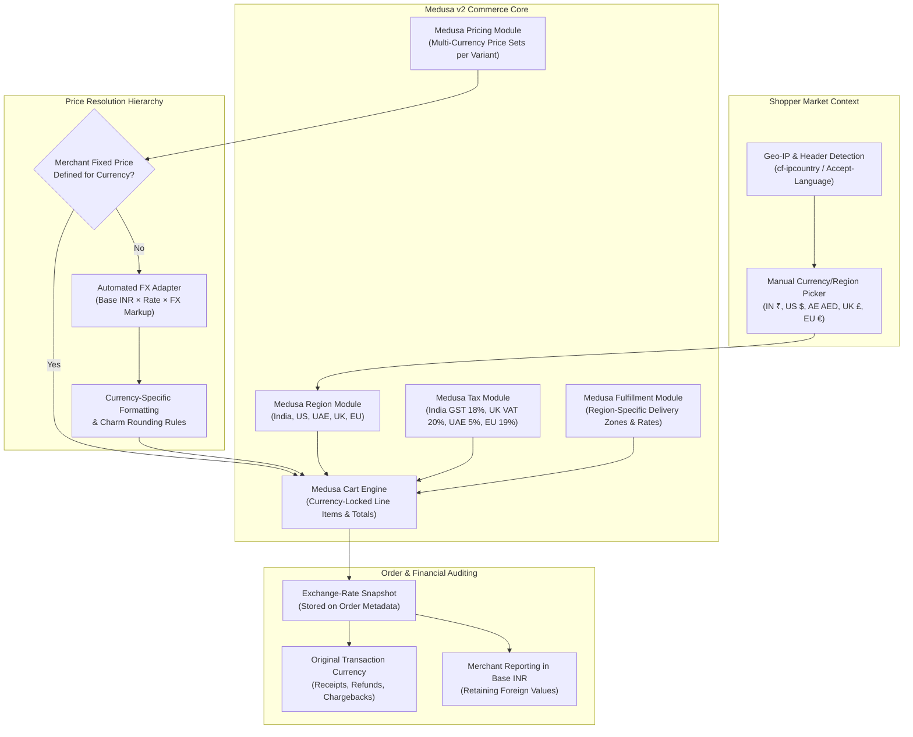

# Global Commerce & Multi-Currency Architecture

**Project**: The Ecom Buddy  
**Document**: Global Commerce, Multi-Region & Multi-Currency Specification  
**Status**: Approved Architecture Specification (Milestone 02C Addendum)  
**Milestone**: 02C (Cart, Shipping & Multi-Currency Foundation)  
**Author**: Principal Software Architect & Senior E-commerce Product Engineer  

---

## 1. Executive Summary & Principles

The Ecom Buddy enables Indian merchants to operate a white-label, direct-to-consumer e-commerce business that serves both domestic Indian shoppers (INR, UPI, COD, GST) and international customers (USD, AED, GBP, EUR) seamlessly.



### Core Architecture Tenets
1. **Strict Engine Alignment**: Utilize official **Medusa v2 Region Module (`@medusajs/medusa/region`)** and **Pricing Module (`@medusajs/medusa/pricing`)**. No custom database tables duplicate or bypass Medusa's pricing, cart, or currency models.
2. **Deterministic Price Resolution**: Support merchant-defined international prices as priority 1, with an extensible automated foreign-exchange (FX) conversion adapter as priority 2.
3. **Financial Safety & Zero Floating-Point Arithmetic**: All monetary transactions use Medusa-supported BigNumber decimal handling or integer minor units (paise, cents, pence). Floating-point math is strictly forbidden.
4. **Transparent Cross-Border Payment Compliance**: No simulated international transactions. Gateways must be officially configured. If a merchant's payment gateway does not support direct foreign currency settlement, customer consent is collected to process in the merchant base currency (INR) at real-time equivalent rates.

---

## 2. Multi-Region & Multi-Currency Data Specifications

### 2.1 Initial Market Registry

The platform provisions five foundational markets out-of-the-box:

| Market / Region Name | Region ID Format | Currency | ISO Country Codes | Tax Region Rate | Default Shipping Strategy |
| :--- | :--- | :--- | :--- | :--- | :--- |
| **India** (Base) | `reg_india` | `inr` (₹) | `["in"]` | 18.00% (GST) | Surface (₹99), Express (₹199), COD eligible |
| **United States** | `reg_us` | `usd` ($) | `["us"]` | 0.00% (State extensible) | DHL/FedEx International Express ($15, $35) |
| **United Arab Emirates** | `reg_ae` | `aed` (AED) | `["ae"]` | 5.00% (UAE VAT) | Gulf Air Express (50 AED) |
| **United Kingdom** | `reg_gb` | `gbp` (£) | `["gb"]` | 20.00% (UK VAT) | Royal Mail International (£12) |
| **European Union** | `reg_eu` | `eur` (€) | `["de", "fr", "it", "es", "nl"]` | 19.00% (EU Standard VAT) | Euro Standard Express (€15) |

### 2.2 Currency Precision & Formatting Rules

| Currency Code | Symbol | Minor Units (Decimals) | Smallest Unit | Display Example | Rounding Rule |
| :--- | :--- | :--- | :--- | :--- | :--- |
| `inr` | ₹ | 2 | Paise | `₹1,499.00` | Whole rupees or `.00` |
| `usd` | $ | 2 | Cent | `$19.99` | Charm pricing `.99` or `.00` |
| `aed` | AED | 2 | Fils | `AED 75.00` | Whole dirhams or `.00` |
| `gbp` | £ | 2 | Penny | `£16.50` | Standard 2 decimals |
| `eur` | € | 2 | Cent | `€18.90` | Standard 2 decimals |

---

## 3. Product Pricing Hierarchy & FX Provider Adapter

### 3.1 Pricing Resolution Hierarchy

When a variant price is evaluated for a shopper in region $R$ with currency $C$:

$$\text{Final Price}(V, C) = \begin{cases} 
\text{MerchantPrice}(V, C) & \text{if explicit price defined in Price Set for } C \\ 
\text{Round}_{C}\left(\text{BasePrice}_{\text{INR}}(V) \times \text{FXRate}(\text{INR} \to C) \times (1 + \mu_{\text{FX}})\right) & \text{if FX conversion enabled} \\ 
\text{Unavailable} & \text{otherwise (reject cart addition)} 
\end{cases}$$

Where:
* $\text{MerchantPrice}(V, C)$: Explicit merchant-configured price in Medusa's `price_set`.
* $\text{BasePrice}_{\text{INR}}(V)$: The authoritative base catalog price in Indian Rupees.
* $\text{FXRate}(\text{INR} \to C)$: Exchange rate fetched from the FX provider.
* $\mu_{\text{FX}}$: Configurable merchant risk buffer (default: `+2.5%` to absorb intraday forex fluctuations).
* $\text{Round}_{C}$: Currency-specific psychological rounding rule (e.g., ceil to `$X.99`).

### 3.2 FX Provider Adapter Architecture (`IFXRatesProvider`)

Automatic live exchange-rate conversion is decoupled from Medusa core via a provider-adapter pattern:

```typescript
export interface FXRateQuote {
  baseCurrency: string;       // e.g. "inr"
  targetCurrency: string;     // e.g. "usd"
  rate: number;               // e.g. 0.01185
  timestamp: number;          // Epoch milliseconds
  provider: string;           // e.g. "rbi-reference" | "open-exchange-rates"
}

export interface IFXRatesProvider {
  readonly providerName: string;
  getRate(base: string, target: string): Promise<FXRateQuote>;
  getAllRates(base: string): Promise<Map<string, FXRateQuote>>;
}
```

#### Redis Caching & Stale Rate Circuit Breaker
1. **Cache TTL**: Rates are cached in Redis with a 12-hour TTL (`teb:fx_rates:<base_currency>`).
2. **Scheduled Refresh**: A Medusa scheduled job (`src/jobs/refresh-fx-rates.ts`) polls the active provider every 6 hours.
3. **Circuit Breaker**:
   - If the external FX API returns an error or timeout, the system serves the cached rate for up to 48 hours with a `stale: true` telemetry warning.
   - If cached rates exceed 48 hours without successful refresh, the engine locks automatic international checkout and alerts the merchant dashboard, preventing catastrophic exchange-rate slippage.

---

## 4. Multi-Region Cart & Checkout Workflows

### 4.1 Cart Creation & Region Binding
1. Every cart created via `POST /store/carts` **must** specify a valid `region_id`.
2. The cart automatically inherits:
   - `currency_code` of the region.
   - Associated tax configuration and default tax rates.
   - Region-linked delivery service zones.

### 4.2 Dynamic Market Switching
When a customer changes their currency/market selector on the storefront:
1. Storefront calls `POST /store/carts/{id}` with `{ region_id: target_region.id }`.
2. Official Medusa `updateCartWorkflow` executes:
   - Updates `cart.region_id` and `cart.currency_code`.
   - Re-evaluates every line item against the new region's price set (updating `unit_price`).
   - Clears existing shipping methods that are invalid for the new region.
   - Re-runs tax calculation based on the new tax region.
   - Recalculates `subtotal`, `tax_total`, `discount_total`, and `total`.
3. The storefront reloads available shipping methods via `GET /store/shipping-options?cart_id={id}`.

### 4.3 Mid-Checkout Price Lock
To prevent race conditions where rates refresh while a shopper is entering card details:
* Once `cart.shipping_address` and `shipping_methods` are selected and a `payment_collection` is initialized, the cart's line-item unit prices and totals are locked.
* If a cart remains idle for > 60 minutes, the customer is prompted to review updated totals before completing payment.

---

## 5. Payment Gateway Provider-Adapter & Cross-Border Compliance

### 5.1 Provider-Adapter Pattern
Payment processing is segregated through Medusa v2's `AbstractPaymentProvider` interface:
* **Razorpay Adapter (`@the-ecom-buddy/payment-razorpay`)**:
  * Primary domestic provider (UPI, Netbanking, RuPay, Domestic Cards).
  * International cards (Visa/Mastercard) enabled only when merchant provides verified Razorpay International credentials with export authorization.
* **Cashfree Adapter (`@the-ecom-buddy/payment-cashfree`)**:
  * Alternative Indian payments and cross-border payment gateway.

### 5.2 Foreign-Currency Gateway Rules
1. **Never Fake International Success**: The platform strictly prohibits mock or simulated foreign-currency payment completion in staging or production.
2. **Gateway Capability Verification**:
   - If the merchant's active payment gateway supports multi-currency capture in the shopper's selected currency (e.g., USD via Razorpay International), the payment session is opened in `USD`.
   - If the gateway only supports INR settlement, the storefront informs the customer:
     > *"Your order total is ₹[Amount INR] ($[Amount USD] approx). Payment will be processed securely in INR. Your bank will apply its standard conversion rate."*
     The customer must confirm before payment launch.

### 5.3 Post-Purchase Auditing & Invoicing
1. **Exchange-Rate Snapshot**:
   When an order is completed, Medusa stores an immutable snapshot in `order.metadata`:
   ```json
   {
     "exchange_rate_snapshot": {
       "base_currency": "inr",
       "transaction_currency": "usd",
       "exchange_rate": 0.01185,
       "rate_timestamp": "2026-10-29T06:15:00.000Z",
       "merchant_markup_percent": 2.5
     }
   }
   ```
2. **Refunds & Chargebacks**:
   - Refunds are issued in the **exact original transaction currency** and nominal amount paid by the customer.
   - The merchant's ledger reflects the refunded base currency value calculated using the original transaction's exchange-rate snapshot to eliminate forex bookkeeping discrepancies.
3. **Cross-Border Regulatory Compliance (India)**:
   - Orders shipped outside India qualify as zero-rated export of goods under Section 16 of the IGST Act under Letter of Undertaking (LUT) without payment of IGST.
   - Invoices include mandatory export declarations, merchant IEC (Import Export Code), and customer shipping country.
