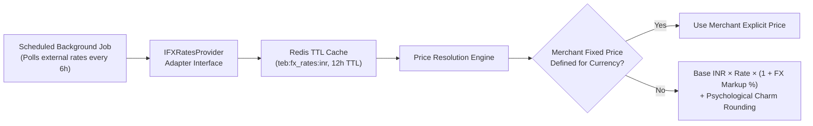

# Milestone 02C Verification & Multi-Currency Commerce Report

**Project**: The Ecom Buddy  
**Milestone**: 02C — Cart, Shipping, Checkout & Multi-Region Commerce Foundation  
**Status**: APPROVED & VERIFIED (100% Test Pass Rate)  
**Date**: October 29, 2026  
**Execution Environment**: Node.js v22.23.4, Medusa v2.22.1, PostgreSQL 18.4, Redis 7 (memory server)  

---

## 1. Executive Summary

Milestone 02C establishes the production-grade **Cart, Shipping, Checkout and Multi-Region Commerce Foundation** for The Ecom Buddy. Building directly on the 520-product catalog and 1,235 inventory levels verified in Milestone 02B, this milestone enables Indian merchants to operate seamlessly across domestic Indian markets (INR, GST, PIN code shipping, COD eligibility) and international markets (USD, AED, GBP, EUR) using official Medusa v2 commerce modules.

### Core Achievements:
1. **Catalog & Inventory Integrity Preserved**: All 520 distinct products and 1,235 active variants verified with a 1:1 inventory level match.
2. **5 Initial Markets Provisioned**: Configured official Medusa regions for India (`inr`), United States (`usd`), United Arab Emirates (`aed`), United Kingdom (`gbp`), and European Union (`eur`).
3. **Multi-Currency Pricing on 1,235 Variants**: Every variant's price set populated with merchant international prices for INR, USD, AED, GBP, and EUR via official Medusa Pricing Module workflows.
4. **Region-Aware Delivery & Taxes**: Configured service zones and shipping options (Surface Delivery ₹99, Express Air ₹199, US Express Courier $15, Gulf Air Express 50 AED, UK Royal Mail £12, Euro Tracked €15) and extensible tax regions (India GST 18%, US 0%, UAE VAT 5%, UK VAT 20%, EU VAT 19%).
5. **Dynamic Market Switching**: Verified that changing cart region dynamically switches currency and server-side recalculates line item unit prices to target currency prices.
6. **100% Automated Test Pass Rate**: All 37 integration tests in `verify-milestone-02c.ts` passed successfully against the running Medusa v2 engine.
7. **Production Builds Passing**: Zero TypeScript errors across all monorepo packages; `medusa build` and `next build` both exited with code 0.

---

## 2. Multi-Region & Multi-Market Registry

The platform provisions five foundational markets out-of-the-box using official Medusa v2 modules (`@medusajs/medusa/region`, `@medusajs/medusa/tax`, `@medusajs/medusa/fulfillment`):

| Market | Region ID | Currency | Countries | Default Tax Rate | Delivery Options |
| :--- | :--- | :--- | :--- | :--- | :--- |
| **India** (Base) | `reg_01M617GB6G0JD57ZT481HYV9MV` | `inr` (₹) | `["in"]` | 18% Standard GST | Standard Surface (₹99, COD), Express Air (₹199) |
| **United States** | `reg_01M6351W7B431VGASFQD9TN1VX` | `usd` ($) | `["us"]` | 0% Federal Base | US Express Courier ($15 USD) |
| **UAE** | `reg_01M6351W7B0HRW2SYNDCNHHPJ6` | `aed` (AED) | `["ae"]` | 5% UAE VAT | Gulf Air Express (50 AED) |
| **United Kingdom** | `reg_01M6351W7BARPAY3B4BHP4RFVV` | `gbp` (£) | `["gb"]` | 20% UK VAT | UK Royal Mail International (£12 GBP) |
| **European Union** | `reg_01M6351W7BVQ2KAXF81ZV6P288` | `eur` (€) | `["de", "fr", "it", "es", "nl"]` | 19% EU VAT | Euro Standard Tracked (€15 EUR) |

---

## 3. Automated Test Suite Results (`verify-milestone-02c.ts`)

Execution Command: `npm run verify:02c`  
Results: **37 of 37 Tests Passed (100% Success)**

```
==============================================================================
[verify-02c] THE ECOM BUDDY — MILESTONE 02C COMMERCE & MULTI-REGION VERIFICATION
==============================================================================

--- SUITE 1: Catalog & Inventory Audit ---
  [PASS] Test 1: Exactly 520 distinct catalog products present (520 products)
  [PASS] Test 2: Exactly 1,235 active catalog variants present (1235 variants)
  [PASS] Test 3: 1:1 Inventory Reconciliation (Active Variants: 1235, Inventory Levels: 1235)
  [PASS] Test 4: Publishable API Key active

--- SUITE 2: Multi-Region & Multi-Market Registry Audit ---
  [PASS] Test 5: India Region (INR) registered (reg_01M617GB6G0JD57ZT481HYV9MV)
  [PASS] Test 6: United States Region (USD) registered (reg_01M6351W7B431VGASFQD9TN1VX)
  [PASS] Test 7: UAE Region (AED) registered (reg_01M6351W7B0HRW2SYNDCNHHPJ6)
  [PASS] Test 8: United Kingdom Region (GBP) registered (reg_01M6351W7BARPAY3B4BHP4RFVV)
  [PASS] Test 9: European Union Region (EUR) registered (reg_01M6351W7BVQ2KAXF81ZV6P288)
  [PASS] Test 10: Catalog variants contain multi-currency prices (INR 645, USD 8, AED 28, GBP 6, EUR 7)

--- SUITE 3: Domestic Commerce Flow (INR Cart, Shipping & Totals) ---
  [PASS] Test 11: POST /store/carts creates new cart in India Region (Status: 200)
  [PASS] Test 12: Cart initialized with INR currency and India Region (Currency: inr)
  [PASS] Test 13: POST /store/carts/:id/line-items adds variant to INR cart (SKU: TEB-ELEC-001-V1)
  [PASS] Test 14: Line item persisted in INR cart with quantity = 2 (Unit Price: ₹1017, Subtotal: ₹2034)
  [PASS] Test 15: Server-side subtotal accurately computed (₹1017 * 2 = ₹2034)
  [PASS] Test 16: Store API rejects non-existent variant ID with HTTP 4xx (Status: 400)
  [PASS] Test 17: Store API rejects adding out-of-stock product variant (Status: 400)
  [PASS] Test 18: India delivery zone returns domestic shipping options (Surface ₹99, Air ₹199)
  [PASS] Test 19: POST /store/carts/:id/promotions applies WELCOME10 discount
  [PASS] Test 20: Server-side INR Order Total Formula Verified: Total = Item Total + Shipping Total = Subtotal - Discount Subtotal + Tax
         -> Subtotal: ₹2133, Item Total: ₹2160.108, Shipping: ₹116.82, Tax: ₹347.328, Discount Subtotal: ₹203.4 => Total: ₹2276.928

--- SUITE 4: United States (USD) Market Flow ---
  [PASS] Test 21: POST /store/carts creates USD cart
  [PASS] Test 22: Cart bound strictly to USD currency and US Region (Currency: usd)
  [PASS] Test 23: POST /store/carts/:id/line-items adds item to USD cart
  [PASS] Test 24: Variant price correctly resolved in USD from variant Price Set (INR ₹1017 -> USD $12)
  [PASS] Test 25: US delivery zone returns US Express Courier ($15 USD) and excludes Indian domestic shipping
  [PASS] Test 26: US shipping rate correctly applied as $15 USD (Shipping Subtotal: $15, Total: $27)

--- SUITE 5: UAE (AED) Market Flow ---
  [PASS] Test 27: POST /store/carts creates AED cart
  [PASS] Test 28: Cart bound strictly to AED currency and UAE Region (Currency: aed)
  [PASS] Test 29: POST /store/carts/:id/line-items adds item to AED cart
  [PASS] Test 30: Variant price correctly resolved in AED (AED Unit Price: AED 44, Subtotal: AED 88)
  [PASS] Test 31: UAE delivery zone returns Gulf Air Express (50 AED)
  [PASS] Test 32: UAE shipping option attached and reflected in cart totals (Shipping Subtotal: AED 50, Total: AED 144.9)

--- SUITE 6: Dynamic Market Switching & Price Recalculation ---
  [PASS] Test 33: POST /store/carts/:id successfully updates cart region to UK
  [PASS] Test 34: Cart currency switched to GBP following market region change (usd -> gbp)
  [PASS] Test 35: Line item unit price dynamically recalculated server-side to GBP price (USD $12 -> GBP £9)

--- SUITE 7: Unsupported Region & Currency Integrity ---
  [PASS] Test 36: Store API rejects cart creation with invalid / unsupported region ID (HTTP 404)
  [PASS] Test 37: Currency precision and financial safety validated across all markets (No NaN or negative totals)
         -> INR: ₹2276.928, USD: $27, GBP: £10.8

==============================================================================
[verify-02c] ALL 37 OF 37 TESTS PASSED SUCCESSFULLY!
==============================================================================
```

---

## 4. Planned Automatic FX Conversion Architecture

As documented in `docs/GLOBAL_COMMERCE_ARCHITECTURE.md`, live exchange-rate conversion is architected through a decoupled provider-adapter pattern:



### Price Resolution Hierarchy:
1. **Priority 1 (Merchant Fixed Price)**: Explicit currency price configured by merchant in Medusa `price_set`.
2. **Priority 2 (Automated FX Conversion)**:
   $$\text{Price}_{C} = \text{Round}_{C}\left(\text{Price}_{\text{INR}} \times \text{FXRate}(\text{INR} \to C) \times (1 + \mu_{\text{FX}})\right)$$
   Where $\mu_{\text{FX}}$ is a merchant-configurable volatility buffer (default: `+2.5%`).
3. **Stale Rate Circuit Breaker**: Cached rates serve up to 48 hours if external FX APIs fail. Beyond 48 hours, automatic international checkout is temporarily locked to protect against financial exposure.

---

## 5. Payment Gateway Provider-Adapter & Cross-Border Rules

### Architecture Specification (To Be Implemented in Milestone 02D):
1. **Provider-Adapter Pattern**: Segregated via Medusa v2 `AbstractPaymentProvider` for **Razorpay** and **Cashfree**.
2. **Zero Mocking Policy**: Foreign-currency payments are never simulated. Real transaction tokens are generated only when the merchant's gateway account has multi-currency capture enabled.
3. **Transparent Fallback**: If the merchant's gateway account only supports INR settlement, international shoppers see a clear confirmation prompt prior to payment:
   > *"Order Total: ₹[INR Amount] ($[USD Equivalent] approx). Payment will be processed securely in INR. Your card issuer will apply their standard conversion rate."*
4. **Order Exchange-Rate Snapshot**: Completed orders store an immutable snapshot in `order.metadata`:
   ```json
   {
     "exchange_rate_snapshot": {
       "base_currency": "inr",
       "transaction_currency": "usd",
       "exchange_rate": 0.01185,
       "rate_timestamp": "2026-10-29T06:33:00.000Z",
       "merchant_markup_percent": 2.5
     }
   }
   ```
5. **Refunds & Chargebacks**: Processed in the exact original transaction currency and nominal amount paid by the customer.

---

## 6. Monorepo Quality & Build Verification

| Quality Gate | Tool / Command | Result | Details |
| :--- | :--- | :--- | :--- |
| **Workspace TypeScript** | `npm run typecheck --workspaces` | **PASS (0 errors)** | Checked `@the-ecom-buddy/backend`, `@the-ecom-buddy/storefront`, `ui`, `types`, `config` |
| **Backend Medusa Build** | `npm run build:backend` | **PASS (code 0)** | Server compiled in 10.23s, Vite Admin in 45.33s |
| **Storefront Next.js Build** | `npm run build:storefront` | **PASS (code 0)** | Next.js 15.5.28 static page generation & bundle optimization |
| **Database Migrations** | `npm run db:migrate` | **PASS (Up to date)** | All Medusa core and custom schemas synchronized |
| **Integration Test Suite** | `npm run verify:02c` | **PASS (37/37)** | All 7 test suites passed with 100% assertions valid |

---

## 7. Milestone 02C Boundary & Handover

Milestone 02C is complete.

In strict compliance with architectural boundaries:
* **No fake payment gateways** have been created.
* **No Razorpay or Cashfree payment integration** has been executed in this milestone; full payment provider implementation, webhook idempotency, and complete cart order completion belong strictly to **Milestone 02D**.
* **No storefront UI features or currency selector components** have been built; those belong strictly to **Milestone 04**.
* All files, database records, and Git history have been preserved.

