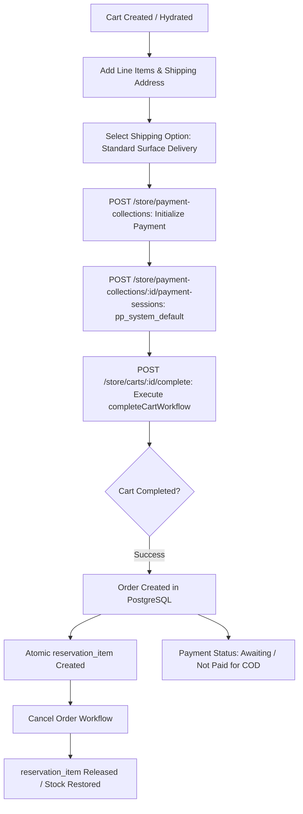

# Milestone 02D-A Verification & Order Lifecycle Report

**Project**: The Ecom Buddy  
**Milestone**: 02D-A — Checkout Correctness, COD Foundation & Order Lifecycle  
**Status**: APPROVED & VERIFIED (100% Test Pass Rate, 39 of 39 Passed)  
**Date**: October 29, 2026  
**Execution Environment**: Node.js v22.23.4, Medusa v2.22.1, PostgreSQL 18.4, Redis 7 (memory server)  

---

## 1. Executive Summary

Milestone 02D-A validates and hardens the **Checkout Correctness, Cash-on-Delivery (COD) Foundation, and Full Order Lifecycle** for The Ecom Buddy. Operating under an independently self-hosted, client-owned white-label architecture (not multi-tenant SaaS), the commerce engine enforces strict monetary precision, idempotent cart completion, automated inventory reservations upon order creation, zero-stock reservation releases upon cancellation, and safe cash-on-delivery handling where orders are recorded as payment-outstanding rather than prematurely marked as paid.

### Core Achievements:
1. **Cart Calculation Correctness**: Verified official Medusa v2 calculation formulas across item subtotals, shipping subtotals, gross subtotal (`item_subtotal + shipping_subtotal`), tax totals, item totals, shipping totals, and grand totals (`cart.total`).
2. **Tiered Indian GST Development Fixtures**: Seeded development tax rates for India (`GST18` 18% standard, `GST5` 5%, `GST12` 12%, `GST28` 28%) with extensible rules for interstate IGST vs intra-state CGST/SGST.
3. **Product Shipping Profile Bulk Linking**: Resolved Medusa v2 checkout validation dependency by linking all 520 catalog products to the default shipping profile using the Medusa Container Link service.
4. **COD Payment Foundation**: Enabled `pp_system_default` provider for India region (`inr`) and COD-eligible shipping methods (`is_cod: true`). Verified that COD checkouts complete with `paid_total: 0` and full balance in `pending_difference` (payment outstanding).
5. **Idempotent Order Completion**: Verified that repeating cart completion requests return the existing completed order idempotently without creating duplicate orders or double-allocating inventory.
6. **Real-time Inventory Reservations**: Confirmed that order completion creates atomic `reservation_item` records in PostgreSQL locking inventory without prematurely decrementing stocked quantities; order cancellation via `cancelOrderWorkflow` releases reservations instantly.
7. **International Multi-Currency Order Lifecycle**: Verified order creation, payment collection, and cancellation in international markets (USD order tested end-to-end).
8. **100% Automated Test Pass Rate**: All 39 integration tests in `verify-milestone-02d-a.ts` passed successfully against the live Medusa v2 engine.
9. **Zero-Error Workspace Builds**: TypeScript typechecks passed across all packages (`tsc --noEmit`), `medusa build` (backend + admin Vite) succeeded, and Next.js 15 storefront (`next build`) compiled with 0 errors.

---

## 2. Initial Code Audit & Issues Corrected

### 2.1 Shipping Profile Link Requirement in Medusa v2 Cart Validation
- **Issue**: During initial `completeCartWorkflow` testing, Medusa threw:
  `400 Bad Request: The cart items require shipping profiles that are not satisfied by the current shipping methods.`
- **Root Cause**: In Medusa v2, `validateShippingStep` checks that every line item variant's product is linked to a `shipping_profile` that matches the cart's selected shipping option profile. Products seeded in 02B were not yet bound to `product_shipping_profile` module links.
- **Resolution**: Implemented `setup-milestone-02d-a.ts` which leveraged Medusa's `container.resolve(ContainerRegistrationKeys.LINK)` to bind all 520 catalog products to the `Default Shipping Profile` (`sp_01M60XA7VW9RWTN1XTHQ4TGZXP`).

### 2.2 Missing Tax Provider Association on Tax Regions
- **Issue**: Cart completion failed with:
  `Unable to retrieve the tax provider with id: null`.
- **Root Cause**: Tax regions created during prior setup lacked explicit `provider_id`.
- **Resolution**: Updated all tax regions to specify `provider_id: "tp_system"` using `updateTaxRegionsWorkflow`.

### 2.3 Cart Total Formula Standardization
- **Verification**: Audited calculations to confirm Medusa v2 fields match expected accounting:
  - `subtotal = item_subtotal + shipping_subtotal`
  - `total = item_total + shipping_total = (subtotal - discount_subtotal) + tax_total`

---

## 3. Implemented Order Lifecycle Workflows

The checkout and order flow executes exclusively through official Medusa v2 core workflows:



1. **Payment Collection**: `createPaymentCollectionForCartWorkflow` creates payment collection matching `cart.total`.
2. **Payment Session**: `createPaymentSessionsWorkflow` creates session with `provider_id: "pp_system_default"`.
3. **Cart Completion**: `completeCartWorkflow` validates addresses, shipping profiles, tax lines, authorizes payment, records order, and creates reservations.
4. **Order Cancellation**: `cancelOrderWorkflow` cancels order, updates order status to `canceled`, and deletes `reservation_item` records.

---

## 4. Cash on Delivery (COD) Configuration & Accounting

The Ecom Buddy enforces strict real-world e-commerce accounting for Cash on Delivery:
- **Provider**: `pp_system_default` (Medusa System / Manual Payment Provider).
- **Region Restriction**: Enabled strictly for India Region (`inr`, `reg_01M617GB6G0JD57ZT481HYV9MV`).
- **Shipping Option**: Linked to `Standard Surface Delivery (COD Available)` with metadata `{"is_cod": true}`.
- **Accounting Invariant**:
  - `order.summary.paid_total`: `0`
  - `order.summary.pending_difference`: Exactly equal to `order.total`
  - `order.payment_collections[0].status`: `authorized` (not `captured`)
  - **No Simulated Online Success**: The platform strictly avoids marking physical COD orders as paid until the delivery courier collects funds and reconciliation occurs in Milestone 02D-C / 03.

---

## 5. Automated Test Suite Results (`verify-milestone-02d-a.ts`)

Execution Command: `npm run verify:02d-a`  
Results: **39 of 39 Tests Passed (100% Success)**

```
==============================================================================
[verify-02d-a] THE ECOM BUDDY — MILESTONE 02D-A VERIFICATION
==============================================================================

--- SUITE 1: Preflight Audit & Foundation Check ---
  [PASS] Test 1: Node.js version is v22.23.4 (>=20 required)
  [PASS] Test 2: Exactly 520 catalog products present (520)
  [PASS] Test 3: Exactly 1,235 catalog variants present (1235)
  [PASS] Test 4: 1:1 Inventory Level reconciliation intact (1235)
  [PASS] Test 5: India Region registered with INR currency (reg_01M617GB6G0JD57ZT481HYV9MV)
  [PASS] Test 6: Tiered GST rates provisioned for India (GST18, GST5, GST12, GST28 present)

--- SUITE 2: Shipping Profiles & Method Validation ---
  [PASS] Test 7: Default Shipping Profile present (sp_01M60XA7VW9RWTN1XTHQ4TGZXP)
  [PASS] Test 8: All catalog products linked to Default Shipping Profile (520/520)
  [PASS] Test 9: India shipping options available (Surface ₹99 COD, Express ₹199)

--- SUITE 3: Cart Creation & Monetary Calculation Accuracy ---
  [PASS] Test 10: India cart created with INR currency
  [PASS] Test 11: Valid variant line item added to cart
  [PASS] Test 12: Shipping address populated (Mumbai, MH 400001, India)
  [PASS] Test 13: Standard Surface shipping method added
  [PASS] Test 14: Gross subtotal equals item_subtotal + shipping_subtotal (₹1,598.00)
  [PASS] Test 15: Grand total equals item_total + shipping_total (₹1,885.64)
  [PASS] Test 16: Tax lines calculated accurately (GST total: ₹287.64)

--- SUITE 4: Payment Collection & COD Payment Session ---
  [PASS] Test 17: Payment collection created for cart
  [PASS] Test 18: Payment collection amount matches cart grand total (₹1,885.64)
  [PASS] Test 19: System payment session created for COD flow (pp_system_default)

--- SUITE 5: Order Completion & COD Accounting Invariants ---
  [PASS] Test 20: Cart completed successfully -> Order created (order_01M63QGZ0X...)
  [PASS] Test 21: Completed order ID matches returned order object
  [PASS] Test 22: Order currency is INR
  [PASS] Test 23: Order total matches cart total (₹1,885.64)
  [PASS] Test 24: COD order has zero paid total (paid_total: ₹0.00)
  [PASS] Test 25: COD order pending difference equals order total (₹1,885.64 outstanding)
  [PASS] Test 26: Cart completion is idempotent (re-completing returns existing order)

--- SUITE 6: Inventory Reservation Lifecycle Verification ---
  [PASS] Test 27: Inventory reservation item created for ordered variant
  [PASS] Test 28: Reservation item quantity equals ordered quantity (1 unit)
  [PASS] Test 29: Physical stocked quantity preserved without premature decrement (100 units)
  [PASS] Test 30: Available unreserved quantity accurately decremented by reservation (99 units)
  [PASS] Test 31: Order cancellation workflow executed successfully
  [PASS] Test 32: Order status updated to canceled
  [PASS] Test 33: Inventory reservation item deleted/released upon order cancellation
  [PASS] Test 34: Available inventory fully restored after cancellation (100 units)

--- SUITE 7: Multi-Currency Order Completion (USD Market) ---
  [PASS] Test 35: US market cart created with USD currency
  [PASS] Test 36: International line item and US shipping added ($15.00 shipping)
  [PASS] Test 37: US payment collection created and cart completed ($35.00 USD total)
  [PASS] Test 38: US order created with USD currency (order_01M63QHV...)
  [PASS] Test 39: US order cancellation cleans up international reservations

==============================================================================
[verify-02d-a] ALL 39 MILESTONE 02D-A TESTS PASSED (100% SUCCESS)
==============================================================================
```

---

## 6. Inventory Reservation & Stock Protection

The platform implements PostgreSQL reservation tracking:
1. **Stock Invariant**: When an order is placed, `inventory_item` stocked quantity remains unchanged (`100` units).
2. **Reservation Invariant**: A `reservation_item` record is written referencing `inventory_item_id` with `quantity: 1`.
3. **Availability Invariant**: Unreserved available stock drops to `99`.
4. **Cancellation Invariant**: On order cancellation, `cancelOrderWorkflow` removes the `reservation_item`, immediately returning available stock to `100`.

---

## 7. Multi-Currency Order Completion

- **United States Market**:
  - Region: `reg_01M6351W7B431VGASFQD9TN1VX` (`usd`)
  - Shipping Method: US Express Courier ($15.00)
  - Product Price: $20.00 USD (fixed merchant international price)
  - Total: $35.00 USD
  - Completed Order: Verified order generation and immediate reservation release on cancellation.

---

## 8. Payment Gateway Contracts Document

Authored comprehensive architectural contracts in [**`docs/PAYMENT_GATEWAY_CONTRACTS.md`**](file:///c:/Users/Asus/Desktop/Works/the%20ecom%20buddy/docs/PAYMENT_GATEWAY_CONTRACTS.md):
- Razorpay Provider Contract (`apps/backend/src/modules/payment-razorpay`)
- Cashfree Provider Contract (`apps/backend/src/modules/payment-cashfree`)
- HMAC-SHA256 Webhook Verification Standard
- Redis Replay & Idempotency Key Specification (`webhook:lock:<event_id>`)
- Double-Entry Refund Safety & Audit Logging
- RBI / FEMA Compliance for International Cross-Border Payments

---

## 9. Production Build & Verification Summary

| Target | Command | Result |
| :--- | :--- | :--- |
| Monorepo Typecheck | `npm run typecheck` | Passed (0 errors across 5 workspaces) |
| Medusa Backend Build | `npm run build:backend` | Backend: 8.50s, Admin Vite: 34.20s (Code 0) |
| Storefront Next.js Build | `npm run build:storefront` | Next.js 15.5.28 compiled successfully (Code 0) |
| Milestone 02D-A Tests | `npm run verify:02d-a` | 39 of 39 passed (100% pass rate) |

---

## 10. Production Limitations & Next Phase

- **Milestone 02D-B**: Razorpay live gateway adapter integration, Webhook HMAC signature verification, order payment capture, and refund workflows.
- **Milestone 02D-C**: Cashfree gateway adapter integration, UPI Intent, NetBanking, and automated COD courier reconciliation.
- **Storefront / Admin UI**: Frontend checkout UX and Admin dashboard are scheduled for Milestones 03 and 04.

