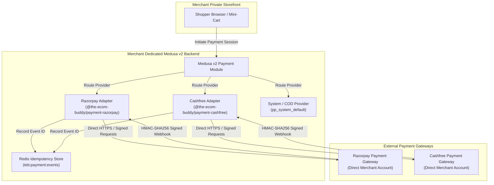

# Payment Gateway Provider Contracts & Specifications

**Project**: The Ecom Buddy  
**Document**: Payment Gateway Provider Contracts & Security Architecture  
**Status**: Milestone 02D-A Specification (Pre-Implementation Architecture)  
**Target Milestone**: 02D-B (Razorpay Gateway) & 02D-C (Cashfree Gateway)  
**Author**: Principal Software Architect & Senior E-commerce Product Engineer  

---

## 1. Architectural Model: Independent Client Installation

The Ecom Buddy is **independently self-hosted, white-label software** licensed directly to individual merchants. It is **NOT** a centrally hosted multi-tenant SaaS.

### Core Non-Negotiable Tenets:
1. **Direct Merchant Settlement**: Payment provider credentials (`API Key`, `API Secret`, `Webhook Secret`) are configured directly in the merchant's private installation. All transactions flow directly between the shopper, the merchant's server, and the payment gateway (Razorpay/Cashfree). Under no circumstances do transactions route through a central SaaS server.
2. **Zero Mock Policy**: The platform never simulates successful payment capture. Payment capture is recorded if and only if the gateway verifies cryptographic authorization.
3. **Currency Transparency**: International payments execute in foreign currencies (USD, AED, EUR, GBP) only when the merchant's payment gateway account has active cross-border capabilities. If unsupported, the customer is prompted to confirm settlement in the merchant base currency (`INR`) at real-time equivalent rates.



---

## 2. Razorpay Provider Contract (`@the-ecom-buddy/payment-razorpay`)

### 2.1 Interface & Lifecycle
The Razorpay adapter implements Medusa v2's `AbstractPaymentProvider`:

```typescript
export interface IRazorpayPaymentProvider {
  initiatePayment(context: CreatePaymentProviderSession): Promise<PaymentProviderSessionResponse>;
  authorizePayment(paymentSessionData: Record<string, unknown>, context: Record<string, unknown>): Promise<PaymentProviderSessionResponse>;
  capturePayment(paymentData: Record<string, unknown>): Promise<PaymentProviderSessionResponse>;
  refundPayment(paymentData: Record<string, unknown>, refundAmount: number): Promise<PaymentProviderSessionResponse>;
  cancelPayment(paymentData: Record<string, unknown>): Promise<PaymentProviderSessionResponse>;
  getWebhookActionAndData(webhookData: ProviderWebhookPayload): Promise<WebhookActionResult>;
}
```

### 2.2 Payment Initialization & Order Creation
1. Storefront calls `POST /store/payment-collections/:id/payment-sessions` with `provider_id: "razorpay"`.
2. Backend generates a Razorpay Order:
   * `amount`: Cart total converted to integer paise ($\text{amount} \times 100$) for INR, or cents for USD.
   * `currency`: Matching cart currency (`INR`, `USD`, `EUR`, `GBP`, `AED`).
   * `receipt`: Cart ID (`cart_...`).
   * `notes`: Internal merchant audit metadata.
3. Razorpay returns `order_id` (e.g. `order_K5Xz...`).
4. Storefront launches Razorpay Standard Checkout SDK (`Razorpay(options).open()`).

### 2.3 Webhook Verification & Idempotency
* **Signature Verification**: Every incoming webhook on `/hooks/payment/razorpay` validates the header `x-razorpay-signature`:
  $$\text{Expected Signature} = \text{HMAC-SHA256}(\text{Raw Request Body}, \text{Razorpay Webhook Secret})$$
* **Event Replay Protection**:
  * Gateway event IDs (`x-razorpay-event-id`) are stored in Redis (`teb:webhook:razorpay:<event_id>`) with a 72-hour TTL.
  * Duplicate event IDs return `HTTP 200 OK` immediately without re-executing workflow steps.
* **Webhook Event Mapping**:
  * `payment.authorized`: Sets session to authorized; triggers `completeCartWorkflow` if not already completed by client return.
  * `payment.captured`: Updates payment status to `captured`.
  * `payment.failed`: Records error reason; keeps cart available for customer retry without duplicate reservation creation.
  * `refund.processed`: Records gateway refund ID and updates order financial summary.

### 2.4 Currency & Merchant Account Eligibility
* **Domestic (INR)**: UPI (Intent, QR, Collect), Netbanking (50+ banks), Domestic Cards (RuPay, Visa, Mastercard), Wallets, EMI.
* **International (USD, EUR, GBP, AED)**: Activated only when the merchant has provided export documentation (IEC Code) and Razorpay has enabled international card processing.
* **Settlement**: Handled directly by Razorpay to the merchant's Indian current account (T+2 business days).

---

## 3. Cashfree Provider Contract (`@the-ecom-buddy/payment-cashfree`)

### 3.1 Interface & Order Lifecycle
1. Backend creates Cashfree PG Order (`POST https://api.cashfree.com/pg/orders`):
   * `order_id`: Unique installation order ID.
   * `order_amount`: Exact monetary total.
   * `order_currency`: `INR`, `USD`, etc.
   * `customer_details`: Customer ID, email, phone.
2. Cashfree returns `payment_session_id`.
3. Storefront loads Cashfree Web JS SDK component.

### 3.2 Webhook Signature & Event Verification
* **Signature Algorithm**: Validates `x-webhook-signature` using HMAC-SHA256 computed over `x-webhook-timestamp` + raw payload.
* **Idempotency**: Cached in Redis (`teb:webhook:cashfree:<event_id>`).

---

## 4. Cash on Delivery (COD) Contract (`pp_system_default`)

### 4.1 Eligibility Rules
* **Region**: Enabled **strictly** for India Region (`inr`).
* **Shipping Option**: Enabled **strictly** for shipping options where `is_cod: true` (e.g. `Standard Surface Delivery`).
* **Express Air & International**: COD is strictly disabled (`is_cod: false`).

### 4.2 Accounting & Financial Safety
* **Order Status at Completion**: `payment_status: "awaiting"` / `summary: { paid_total: 0, pending_difference: order.total }`.
* **Zero Fake Capture**: COD orders are **never** marked as paid at checkout. Payment capture occurs manually via merchant admin upon delivery confirmation by logistics partners (Shiprocket/Delhivery).

---

## 5. Security & Regulatory Compliance

1. **No Central Intermediary**: Client credentials (`RAZORPAY_KEY_ID`, `RAZORPAY_KEY_SECRET`, `CASHFREE_APP_ID`, `CASHFREE_SECRET_KEY`) are stored solely in the client's local `.env` or encrypted database configuration.
2. **RBI FEMA & Cross-Border Guidelines**:
   * Export transactions include customer delivery country and merchant IEC.
   * Exports shipped under Letter of Undertaking (LUT) are assessed 0% IGST with mandatory declaration on tax invoices.
3. **PCI DSS SAQ-A Posture**:
   * All cardholder data is collected exclusively within hosted iframe fields (Razorpay Checkout / Cashfree Drop-in).
   * Merchant servers never touch or store PAN, CVV, or card PIN numbers.
