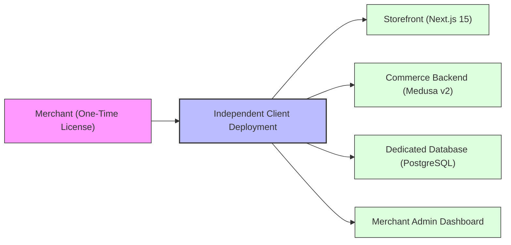

# Product Requirements Document (PRD)

**Project**: The Ecom Buddy  
**Document**: Product Requirements Document (PRD)  
**Status**: Approved for Architecture Review  
**Milestone**: 01 (Foundation & Technical Specification)  
**Author**: Principal Software Architect & Senior E-commerce Product Engineer  

---

## 1. Executive Summary & Product Vision

**The Ecom Buddy** is a high-performance, production-grade white-label e-commerce platform designed to dismantle the predatory recurring monthly subscription model enforced by conventional SaaS platforms (Shopify, BigCommerce, Wix). 

Instead of imposing permanent platform taxes, revenue rev-share percentages, and expensive monthly app fees, The Ecom Buddy delivers an **enterprise-class, one-time software license** with **independent, self-hosted client deployments**.

The platform is purpose-built to combine the technical power, security, and scalability of modern headless architectures with the simplicity, polished aesthetics, and ease of use expected by non-technical merchants.

---

## 2. Business Model & Value Proposition

### 2.1 The One-Time License Model
1. **Ownership & Independence**: The merchant purchases a lifetime software license for a single production domain (and staging/local environments). 
2. **Zero Mandatory Subscriptions**: Merchants pay standard hosting fees (e.g., $10–$25/month on any standard VPS or PaaS) and payment processing fees directly to their merchant processor (e.g., Stripe, Razorpay). No monthly platform toll.
3. **Data Sovereignty**: Customer databases, transaction records, inventory, and analytics remain strictly in the merchant's private database instance. No vendor data-mining or platform de-platforming risk.
4. **White-Label Delivery**: The platform contains zero vendor watermarks. The merchant can brand the storefront, administrative console, transactional emails, and packing slips completely under their business identity.

### 2.2 Target Merchant Persona
* **Profile**: Small-to-Medium Business (SMB) owners, retail boutique proprietors, direct-to-consumer (D2C) brand founders, and creative artisans managing catalogs of 500+ products.
* **Technical Literacy**: Low to non-technical. They are experts in their products and marketing, not in Git, Docker, terminal commands, or database schemas.
* **Core Frustrations with Existing Solutions**:
  * Shopify monthly bills escalating due to 15+ micro-apps required for basic functionality (carousel sliders, SEO schemas, CAPI tracking, custom fields).
  * WooCommerce fragility, database bloat, plugin update crashes, and sluggish page speed.
  * Complex headless solutions requiring full-time DevOps engineers.
* **Merchant Expectation**: A turnkey, rock-solid admin experience where catalog updates, promotional banners, payment credentials, and order fulfillment can be executed in seconds without writing code.

---

## 3. Core Functional Requirements

### 3.1 Catalog & Product Architecture (500+ SKUs)
* **Scale**: High-performance indexing and immediate search/filter responsiveness across 500 to 10,000 active SKUs.
* **Variant System**: Multi-attribute variant matrix (e.g., Size $\times$ Color $\times$ Material). Automatic generation of SKU combinations with distinct pricing, inventory counts, weight, and barcode/EAN fields.
* **Taxonomy**: Hierarchical categories (e.g., *Apparel > Women > Jackets*), curated collections (e.g., *Winter Essentials, Best Sellers*), and faceted tag filters.
* **Media Management**: Multiple high-resolution images per product/variant, automated WebP conversion, drag-and-drop sort order, and thumbnail focal-point preservation.

### 3.2 Inventory & Stock Control
* **Location-Aware Inventory**: Single or multi-location stock levels with unified visibility.
* **Low Stock Alerts**: Configurable low-stock thresholds triggering visual dashboard warnings and optional merchant email notifications.
* **Backorder Controls**: Per-product and per-variant policy toggles (`Deny`, `Allow`, `Allow with Notification`).
* **Concurrency-Safe Stock Reservation**: Items placed into an active checkout session are temporarily reserved (15-minute TTL) to prevent overselling high-demand inventory during traffic surges.

### 3.3 Storefront Customization & Homepage Carousel
* **Curated Six-Slide Homepage Carousel**:
  * Exactly six structured slides managed via the merchant dashboard.
  * Per-slide controls:
    * Active/Inactive toggle.
    * Slide display position (drag-to-reorder, positions 1 through 6).
    * Desktop banner image asset (optimized 16:9 / 21:9 ratio).
    * Mobile banner image asset (optimized 4:5 / 1:1 ratio for vertical viewports).
    * Headline text (supports high-contrast typography).
    * Subtitle/kicker text.
    * Primary CTA button label (e.g., "Explore Collection") and destination link.
    * Text alignment (Left, Center, Right) and overlay contrast scrim control.
* **Brand Styling Customizer**:
  * Primary brand color, accent color, background surface tone.
  * Logo upload (vector SVG / transparent PNG) and browser favicon.
  * Typography preset selector (pairing elegant display serifs with crisp, legible sans-serif body type).
  * Announcement Bar: Dismissible top ticker with custom message, background color, and optional link.

### 3.4 Shopping Cart & Checkout Experience
* **Cart Drawer (Slide-Over)**:
  * Seamless mini-cart drawer triggering instantly on "Add to Cart" without jarring page redirects.
  * Real-time line item quantity increment/decrement and removal with optimistic UI updates.
  * Dynamic Free Shipping Progress Bar (e.g., *"Add $24.00 more to unlock Free Standard Shipping"*).
  * Order notes input field for special instructions or gift messages.
* **Frictionless One-Page Checkout**:
  * Guest checkout by default; optional 1-click customer account creation.
  * Clear multi-step progression: Customer Info $\rightarrow$ Shipping Address $\rightarrow$ Shipping Method $\rightarrow$ Payment.
  * Live address validation and postal code auto-lookup where supported.
  * Promotional discount code validation engine (percentage discount, fixed sum, or free shipping rules).

### 3.5 Payments & Fulfillment
* **Payment Gateways**:
  * **Stripe**: Card payments, Apple Pay, Google Pay, Link (hosted Elements with zero PCI footprint on application servers).
  * **Regional Alternative Gateway**: Razorpay (for UPI, Netbanking, local cards) or PayPal Commerce.
  * **Manual / Offline Methods**: Cash on Delivery (COD) with verification fee rules, Bank Transfer instructions.
* **Shipping Rules**:
  * Flat-rate shipping zones (Domestic, International, Express).
  * Weight-based and order-subtotal-based tiered shipping rates.
  * Free shipping threshold triggers.
* **Taxes**:
  * Configurable tax rates by region/state/country (tax-inclusive or tax-exclusive display).

### 3.6 Order & Customer Management
* **Order Lifecycle State Machine**:
  * `Pending` $\rightarrow$ `Authorized` $\rightarrow$ `Captured` $\rightarrow$ `Processing` $\rightarrow$ `Fulfilled` $\rightarrow$ `Delivered`.
  * Exception states: `Payment Failed`, `Cancelled`, `Refunded`, `Partially Refunded`, `Returned`.
* **Merchant Fulfillment Actions**:
  * One-click packing slip and commercial invoice generation (PDF).
  * Carrier tracking number entry with customer-facing tracking link generator.
  * Partial fulfillment support for multi-item split shipments.
* **Customer Account Portal**:
  * Order history tracking with live shipping statuses.
  * Saved address book for one-click re-ordering.

### 3.7 Marketing, Analytics & SEO
* **Meta Growth Engine**:
  * Dual-layer Meta Pixel (client-side) and Meta Conversions API (server-side direct POST).
  * Deterministic event deduplication via synchronized `event_id`.
  * E-commerce standard events: `PageView`, `ViewContent`, `AddToCart`, `InitiateCheckout`, `AddPaymentInfo`, `Purchase`.
* **Google Growth Engine**:
  * Google Analytics 4 (GA4) with Google Tag Manager (GTM) dataLayer container.
  * Server-side GA4 Measurement Protocol backup for guaranteed purchase attribution despite client ad-blockers.
* **SEO Machine**:
  * Dynamic, automated `sitemap.xml` splitting catalog items into indexed segments.
  * Robots.txt dynamically generated with crawl budget controls.
  * Automatic JSON-LD Schema injection: `Product`, `Offer`, `BreadcrumbList`, `Organization`, `WebSite`.
  * Merchant-customizable meta title, meta description, and OpenGraph social share card per product and page.

---

## 4. Non-Functional Requirements (NFRs)

| Domain | Specification | Threshold / Standard |
| :--- | :--- | :--- |
| **Performance** | Google Lighthouse (Mobile & Desktop) | Score $\ge 90$ across Performance, Accessibility, Best Practices, SEO |
| **Response Time** | Time to First Byte (TTFB) | $\le 200\text{ ms}$ on cached dynamic SSR routes; $\le 80\text{ ms}$ on edge static assets |
| **Throughput** | Catalog Search & Browsing | Concurrent handling of 500 active shoppers on standard single VPS (4GB RAM) |
| **Security** | Payment Card Security | 100% PCI-DSS SAQ-A compliant (no raw PAN or CVV touches merchant servers) |
| **Security** | Data Protection | HTTPS/TLS 1.3 enforced, HSTS, Argon2/Bcrypt password hashing, SQL injection immunity |
| **Reliability** | Availability & Resilience | 99.9% uptime; automated database snapshotting and transactional rollbacks |
| **Compatibility** | Client Deployment Environments | Dockerized runtime runnable on Ubuntu 22.04/24.04, Debian 12, or container PaaS |

---

## 5. Merchant Usability & Interface Principles

1. **Jargon-Free Vocabulary**: The admin dashboard speaks the language of a merchant, not a software engineer (e.g., *"Product Stock"* instead of *"Inventory Variant Quantity Matrix"*; *"Store Colors"* instead of *"CSS Design Token Overrides"*).
2. **Zero-Code Configuration**: Adding tracking pixels, altering the 6-slide carousel, uploading logos, or updating shipping rates never requires touching `.env` files, code repositories, or JSON snippets.
3. **Guardrails & Reversibility**: Destructive actions (deleting products, cancelling paid orders, resetting theme colors) require explicit confirmation dialogs with clear explanations of consequences.
4. **Predictable Defaults**: Every new deployment arrives pre-populated with sensible defaults (working placeholder carousel slides, standard email templates, pre-configured tax zones) so the store can go live within 60 minutes of software deployment.
