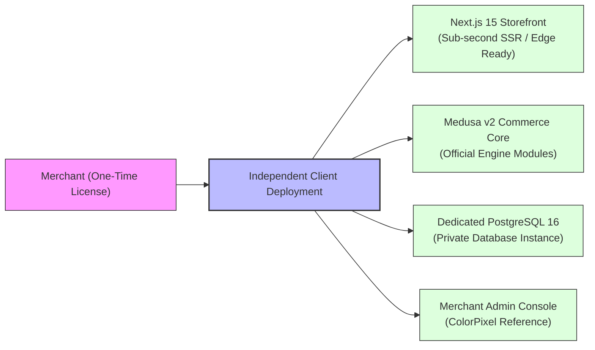

# Product Requirements Document (PRD)

**Project**: The Ecom Buddy  
**Document**: Product Requirements Document (PRD)  
**Status**: Revised Architecture Specification (Post-Review Revision)  
**Milestone**: 01 (Foundation & Technical Specification)  
**Author**: Principal Software Architect & Senior E-commerce Product Engineer  

---

## 1. Executive Summary & Product Vision

**The Ecom Buddy** is a high-performance, production-grade white-label e-commerce platform designed for independent merchant deployments under a **one-time software license** with **zero mandatory recurring monthly platform fees**.

The platform is designed to provide small and medium business (SMB) owners—who often have little to no technical knowledge—with a modern, high-converting direct-to-consumer store. It delivers the speed, security, and extensibility of a modern headless stack (**Medusa v2** + **Next.js 15**) while retaining the operational ease of an intuitive, no-code administrative console.

---

## 2. Business Model & Value Proposition

### 2.1 One-Time License Model & Private Deployment
1. **Perpetual Ownership**: The merchant purchases a lifetime license for their production domain, with zero revenue share and zero mandatory monthly software subscription.
2. **Hosting Independence**: The platform deploys to the merchant's choice of infrastructure (e.g., a standard $10–$25/month Linux VPS or container PaaS).
3. **Data Sovereignty**: The merchant retains 100% ownership of customer data, product catalogs, order history, and analytics logs within their private PostgreSQL instance.
4. **White-Label Delivery**: No vendor branding or watermarks are visible to consumers or merchants unless white-labeled as chosen by the store operator.

### 2.2 Target Merchant Persona
* **Profile**: SMB retailers, brand founders, and creative business operators managing catalogs of **500+ distinct products** with multiple variants (yielding thousands of sellable SKUs).
* **Technical Literacy**: Low to non-technical. Routine administrative tasks (inventory adjustments, carousel slide updates, promotional discounts, order fulfillment) must be completely accessible via an intuitive visual UI.
* **Pain Points Addressed**:
  * Eliminates the escalating monthly "app tax" of hosted platforms.
  * Eliminates plugin fragility and database degradation typical of legacy monolithic CMS platforms.
  * Provides enterprise-grade marketing and telemetry out of the box without fragile third-party extensions.

---

## 3. Product Scale & Catalog Capacity

### 3.1 500+ Distinct Products & Multi-Variant SKU Scale
* **Product Capacity Target**: The architecture and database design are optimized to support a minimum of **500 distinct products** per merchant.
* **Variant & SKU Multipliers**: Each product can support multiple variant dimensions (e.g., Size, Color, Finish, Material). A catalog of 500 distinct products with an average of 3 to 8 variant combinations per product represents **1,500 to 4,000+ distinct sellable SKUs**.
* **Seed Generator Requirement**: The platform's automated seed generator must generate at least 500 realistic, production-quality distinct products with complete variant matrices, pricing, inventory levels, and image galleries to validate realistic catalog load.
* **Query Performance Requirements**: Category filtering, faceted search, and paginated product browsing across the full SKU catalog must achieve sub-100ms database response times using PostgreSQL covering indexes and full-text search.

---

## 4. India-First Architecture with Global Adaptability

The platform is designed with an **India-first baseline configuration** while providing global localization toggles:

### 4.1 Currency & Pricing
* **Primary Currency**: Indian Rupee (`INR` / `₹`) configured as the default currency, formatted with the Indian numbering system (e.g., `₹1,49,999.00`).
* **Multi-Currency Capability**: Full support for international pricing tiers (e.g., `USD`, `EUR`, `GBP`) via Medusa v2's Price List Module.

### 4.2 Payment Gateways
* **Razorpay Integration**: Primary payment gateway supporting:
  * Unified Payments Interface (**UPI**) via QR code, intent flow, and VPA address.
  * Netbanking across all major Indian scheduled banks.
  * Domestic and international Credit/Debit cards (Visa, Mastercard, RuPay, Amex).
  * Major digital wallets and EMI options.
* **Cash on Delivery (COD)**: First-class payment method with merchant-configurable rules:
  * Optional COD convenience fee (flat or percentage).
  * PIN code serviceability verification before COD checkout enablement.
  * Optional SMS/OTP phone verification before COD order authorization.
* **Stripe Integration**: Pre-configured secondary gateway for international card processing, Apple Pay, and Google Pay.

### 4.3 Indian Shipping & Address Structure
* Mandatory 6-digit **PIN Code** with automated state and city lookup.
* Structured address fields: Flat/House No., Street/Area, Landmark, City/District, State/Union Territory dropdown (all 28 states and 8 union territories).
* Logistics aggregator readiness: Schema and event webhooks aligned with Indian logistics providers (Shiprocket, Delhivery, BlueDart).

### 4.4 Goods and Services Tax (GST) & Invoicing
* **HSN Code Support**: Harmonized System of Nomenclature (HSN) codes attached to each product.
* **Split GST Calculation Engine**:
  * **Intra-State Transactions** (Merchant State = Customer Shipping State): Equal split into **CGST** (Central GST) and **SGST** (State GST).
  * **Inter-State Transactions** (Merchant State $\ne$ Customer Shipping State): Single **IGST** (Integrated GST) assessment.
* **B2B Checkout Capability**: Optional input for customer business name and 15-character **GSTIN** with tax-compliant invoice generation.
* **Tax-Inclusive Pricing**: Clear display on storefront product cards (e.g., *"Inclusive of all taxes"*).

---

## 5. Core Functional Requirements

### 5.1 Storefront Customization & Hero Carousel
* **Configurable Homepage Hero Carousel**:
  * **Six default pre-configured slides** are supplied out of the box with high-quality copy, desktop/mobile responsive crops, and call-to-action buttons.
  * **Dynamic Slide Management**: Merchants are **not limited** to six slides. The merchant admin allows merchants to add, edit, disable, reorder, and remove slides dynamically.
  * Per-slide controls:
    * Active / Inactive toggle.
    * Drag-and-drop display ordering.
    * Desktop banner image asset (16:9 / 21:9 responsive ratio).
    * Mobile banner image asset (4:5 / 1:1 portrait ratio).
    * Editorial headline and kicker/subtitle.
    * CTA button label (e.g., *"Explore Collection"*) and destination URL.
    * Text alignment (Left, Center, Right) and contrast scrim opacity.
* **Brand Styling Customizer**:
  * Brand logo, mobile logo, and browser favicon.
  * Primary brand color, accent tone, and surface background tokens.
  * Typography preset selector (pairing editorial display serifs with crisp, legible sans-serif body type).
  * Dismissible announcement bar with customizable text, link, and background tone.

### 5.2 Shopping Cart & Frictionless Checkout
* **Slide-Over Mini-Cart Drawer**:
  * Triggered instantly upon adding items without full-page reloads.
  * Live line-item quantity steppers with optimistic UI updates.
  * Dynamic Free Shipping Progress Bar (e.g., *"Add ₹450 more to unlock Free Express Shipping"*).
  * Cart note input field for delivery instructions.
* **High-Conversion One-Page Checkout**:
  * Guest checkout by default; optional 1-click customer account creation.
  * Progression: Contact $\rightarrow$ Delivery Address $\rightarrow$ Shipping Method $\rightarrow$ Payment.
  * Address validation with PIN code auto-fill for city and state.
  * Discount code validation engine supporting percentage, fixed amount, and free shipping promotions.

### 5.3 Order & Fulfillment Management
* Order lifecycle state transitions managed via official Medusa v2 workflows.
* Split fulfillment and tracking number assignment with automated customer notification.
* Automated printable PDF invoices (with GST breakdown) and packing slips.
* Return and refund handling with automated inventory restock options.

### 5.4 Marketing, Analytics & Telemetry
* **Dual-Layer Meta Tracking**: Browser-side Meta Pixel paired with server-side Meta Conversions API (CAPI), synchronized by a unique, stable `event_id` per logical interaction.
* **Google Analytics 4 & Tag Manager**: Standard GA4 client dataLayer events backed by server-side Measurement Protocol validation for order completion.
* **Consent-Gated Telemetry**: Strict regional privacy enforcement (Google Consent Mode v2); no tracking tags or PII transmission fire without explicit shopper consent.

---

## 6. Measurable Non-Functional Targets & Validation

Rather than relying on unverified generic claims, non-functional performance is governed by measurable engineering targets and concrete validation methodologies:

| Domain | Target Specification | Validation Methodology |
| :--- | :--- | :--- |
| **Server Response Time** | p95 TTFB $\le 300\text{ ms}$ on dynamic SSR; p95 $\le 80\text{ ms}$ on cached static assets. | Load testing via **k6** / **Artillery** simulating 50 concurrent active shopper sessions on standard 4GB VPS. |
| **Catalog Performance** | Sub-100ms query execution across 500+ products (2,500+ SKUs) with faceted filtering. | PostgreSQL `EXPLAIN ANALYZE` benchmarks on indexed search vectors and variant tables. |
| **Frontend Quality** | Google Lighthouse score $\ge 90$ across Performance, Accessibility, Best Practices, and SEO on mobile viewports. | Automated **Lighthouse CI** running on emulated mobile network profiles. |
| **Payment Security** | PCI-DSS SAQ-A qualification; zero customer card data (PAN, CVV) touches merchant servers. | Architectural verification: all payment fields hosted inside Stripe Elements / Razorpay Checkout iframes; validated via annual SAQ-A assessment. |
| **Data Protection** | TLS 1.3 enforced, HSTS enabled, AES-256 encryption at rest for marketing API secrets. | Automated Qualys SSL Labs scan (Target Grade A+) and static security code analysis. |
| **Service Availability** | Docker container auto-restart policies (`restart: unless-stopped`) with health checks. | Automated integration health checks monitoring `/health` endpoints on backend and storefront. |

---

## 7. Merchant Usability & Interface Principles

1. **Jargon-Free Vocabulary**: The admin speaks the language of a merchant (e.g., *"Store Colors"* instead of *"CSS Variables"*; *"Inventory by Size"* instead of *"Variant Matrix Dimensions"*).
2. **Zero-Code Operation**: Managing carousel slides, setting up Razorpay keys, creating GST invoices, and modifying SEO titles never requires editing configuration files or writing code.
3. **Guardrails & Confirmation**: Destructive actions (cancelling paid orders, archiving catalog items) require unambiguous confirmation dialogs.
4. **Instant Polish on Day One**: The initial deployment delivers six pre-configured production carousel slides, sensible default shipping zones, and pre-seeded tax templates so the store is launch-ready within hours.
