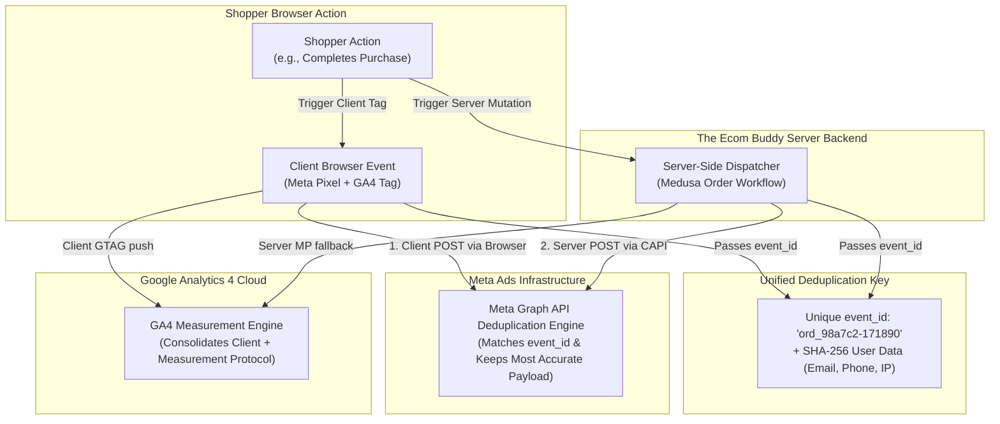

# SEO & Marketing Integration Architecture

**Project**: The Ecom Buddy  
**Document**: SEO & Marketing Integration Plan  
**Status**: Approved for Architecture Review  
**Milestone**: 01 (Foundation & Technical Specification)  
**Author**: Principal Software Architect & Senior E-commerce Product Engineer  

---

## 1. Executive Summary

Organic search visibility and deterministic conversion tracking are existential requirements for modern direct-to-consumer (D2C) brands. Conventional SMB stores routinely lose 30% to 45% of purchase attribution due to browser ad-blockers, iOS Safari Intelligent Tracking Prevention (ITP), and cookie degradation.

**The Ecom Buddy** addresses these challenges at the architectural level:
1. **Automated Search Engine Dominance**: Next.js 15 Server-Side Rendering (SSR), on-demand Incremental Static Regeneration (ISR), automated XML sitemaps, dynamic OpenGraph assets, and rich JSON-LD structured data.
2. **Dual-Layer Meta Tracking (Pixel + Conversions API)**: Client-side browser pixels paired with direct server-to-server Conversions API (CAPI) events, unified by deterministic `event_id` deduplication.
3. **Google Analytics 4 & Measurement Protocol**: Standard GA4 client dataLayer events backed by server-side Measurement Protocol dispatch for purchase verification.
4. **Merchant-Friendly Simplicity**: All tracking IDs, test event codes, and consent policies are managed via the admin UI without touching code or installing third-party apps.



---

## 2. Technical SEO Architecture

### 2.1 Dynamic Rendering & Next.js 15 Metadata API
Every product, collection, and static page dynamically generates crawlable metadata using Next.js 15 `generateMetadata`:
* **Title Hierarchy**: `[Product Title] | [Merchant Brand Name]`
* **Meta Descriptions**: Dynamic extraction from product summary or merchant-customized SEO description (enforced max 160 characters).
* **Canonical URL Enforcement**: Canonical URLs are strictly declared across all paginated and filtered variants to avoid duplicate content penalties.
* **OpenGraph & Twitter Cards**: Dynamic social share previews generated at the edge with product pricing, currency, and high-res thumbnail.

### 2.2 Automated XML Sitemaps
The platform automatically generates and maintains a sitemap index at `/sitemap.xml`, partitioned into focused sitemaps:
* `/sitemap-products.xml`: All active, published products (regenerated automatically on catalog updates via ISR).
* `/sitemap-categories.xml`: Category hierarchy and curated collections.
* `/sitemap-pages.xml`: Core pages (Home, About, Contact, Shipping Policy, Return Policy).

Each entry contains accurate `<lastmod>` timestamps and calculated `<priority>` and `<changefreq>` signals:
```xml
<url>
  <loc>https://example.com/products/linen-shirt</loc>
  <lastmod>2026-10-28T08:00:00Z</lastmod>
  <changefreq>daily</changefreq>
  <priority>0.8</priority>
</url>
```

### 2.3 Crawl Budget & Dynamic `robots.txt`
The `robots.txt` file is dynamically served to maximize search crawler efficiency while locking down sensitive paths:
```txt
User-agent: *
Allow: /
Allow: /products/
Allow: /collections/
Allow: /pages/
Disallow: /cart
Disallow: /checkout
Disallow: /account/
Disallow: /admin/
Disallow: /api/

Sitemap: https://example.com/sitemap.xml
```

### 2.4 Rich JSON-LD Structured Data
Search engines receive structured entity definitions automatically embedded in the `<head>` of relevant pages:

#### Product & Offer Schema
Includes Google Merchant Center compliance attributes:
```json
{
  "@context": "https://schema.org",
  "@type": "Product",
  "name": "Relaxed Tailored Blazer",
  "image": ["https://example.com/images/blazer-1.webp"],
  "description": "Crafted from Italian wool blend...",
  "sku": "BLZ-NAVY-M",
  "brand": {
    "@type": "Brand",
    "name": "Merchant Brand"
  },
  "offers": {
    "@type": "Offer",
    "url": "https://example.com/products/relaxed-tailored-blazer",
    "priceCurrency": "USD",
    "price": "245.00",
    "priceValidUntil": "2027-12-31",
    "itemCondition": "https://schema.org/NewCondition",
    "availability": "https://schema.org/InStock",
    "seller": {
      "@type": "Organization",
      "name": "Merchant Brand"
    },
    "hasMerchantReturnPolicy": {
      "@type": "MerchantReturnPolicy",
      "applicableCountry": "US",
      "returnPolicyCategory": "https://schema.org/MerchantReturnFiniteReturnWindow",
      "merchantReturnDays": 30,
      "returnMethod": "https://schema.org/ReturnByMail"
    }
  }
}
```

#### BreadcrumbList & Organization Schemas
* **BreadcrumbList**: Enables rich breadcrumb navigation directly in Google SERP snippets.
* **Organization & WebSite**: Provides brand identity and declares the `potentialAction: SearchAction` for instant Google Sitelinks search bars.

---

## 3. Dual-Layer Meta Tracking (Pixel + Conversions API)

### 3.1 The Tracking Gap & Why CAPI is Mandatory
Standard client-side browser pixels fail under modern browser restrictions:
* iOS 14.5+ Safari ITP caps browser cookie lifespan to 1–7 days.
* Ad-blockers block requests to `connect.facebook.net` entirely.
* Aggressive mobile memory cleanup terminates background checkout scripts.

The Ecom Buddy solves this via **Synchronized Dual-Layer Tracking**:
1. Client-side pixel fires in the shopper's browser when permitted.
2. Server-side CAPI dispatches directly from the Medusa backend to Meta's Graph API (`/v20.0/{pixel_id}/events`).
3. Both events share the identical `event_id` and `event_name`.
4. Meta's algorithm deduplicates the pair and keeps the server payload's verified customer data, resulting in near **100% purchase attribution**.

### 3.2 Event Funnel Mapping

| E-Commerce Action | Meta Event Name | Client Trigger | Server (CAPI) Trigger | Deduplication Key (`event_id`) |
| :--- | :--- | :--- | :--- | :--- |
| **View Product** | `ViewContent` | Product page mount | Storefront Server Component | `vc_${product.id}_${timestamp}` |
| **Add to Cart** | `AddToCart` | Mini-cart drawer open | Server Action mutation | `atc_${cart.id}_${variant.id}` |
| **Initiate Checkout** | `InitiateCheckout` | Checkout page mount | Checkout session created | `ic_${cart.id}` |
| **Add Payment Info** | `AddPaymentInfo` | Payment step selected | Payment session authorized | `api_${cart.id}` |
| **Complete Purchase** | `Purchase` | Confirmation page | Medusa Order Placed Workflow | `pur_${order.id}` |

### 3.3 Customer Data Matching & Privacy Hashing
Meta Conversions API requires customer parameters to be hashed with `SHA-256` before transmission (except IP and User Agent):
* `em`: Lowercase, trimmed email address $\rightarrow$ SHA-256.
* `ph`: E.164 international phone number $\rightarrow$ SHA-256.
* `fn` / `ln`: First / Last name $\rightarrow$ SHA-256.
* `ct` / `zp` / `country`: City, postal code, 2-letter ISO country $\rightarrow$ SHA-256.
* `client_ip_address`: Direct IPv4 / IPv6 of the shopper.
* `client_user_agent`: Raw browser user agent string.
* `fbp` & `fbc`: Meta browser cookies extracted from incoming HTTP request headers.

---

## 4. Google Analytics 4 & Measurement Protocol

### 4.1 DataLayer Architecture (GA4 & GTM)
The storefront maintains a type-safe `window.dataLayer` implementation adhering to official GA4 Enhanced E-commerce specifications:
* `view_item_list`: Triggered on collection grids with item impressions.
* `view_item`: Triggered on product detail page loads.
* `add_to_cart`: Triggered when an item is added to the slide-over mini-cart.
* `remove_from_cart`: Triggered on line item deletion.
* `view_cart`: Triggered on mini-cart drawer open.
* `begin_checkout`: Triggered on navigating to checkout.
* `add_shipping_info`: Triggered upon selecting a shipping method.
* `add_payment_info`: Triggered upon selecting a payment gateway.
* `purchase`: Triggered on order completion.

### 4.2 Server-Side Measurement Protocol Fallback
When a purchase is confirmed in the Medusa order workflow:
* The backend sends a server-to-server POST request to:  
  `https://www.google-analytics.com/mp/collect?measurement_id=${GA_ID}&api_secret=${API_SECRET}`
* Payload includes:
  * `client_id`: Extracted from the `_ga` cookie passed during checkout.
  * `events`: `[ { name: "purchase", params: { transaction_id, value, currency, items } } ]`
* This guarantees that even if a customer's browser crashes or blocks analytics during payment redirects, the merchant's revenue reports in Google Analytics remain 100% accurate.

---

## 5. Google Consent Mode v2 & Compliance

To comply with European Union regulations (DMA, GDPR) and global privacy standards:
* The platform integrates **Google Consent Mode v2** defaults:
  ```javascript
  gtag('consent', 'default', {
    'analytics_storage': 'denied',
    'ad_storage': 'denied',
    'ad_user_data': 'denied',
    'ad_personalization': 'denied',
    'wait_for_update': 500
  });
  ```
* When the shopper accepts cookies via the platform's native banner, the consent state updates dynamically to `'granted'`, enabling full analytics and ad personalization.

---

## 6. Merchant Marketing Control Center

Non-technical merchants manage all marketing and tracking integrations via a dedicated dashboard view:
1. **Meta Integration Card**:
   * Input fields: *Meta Pixel ID*, *Conversions API Access Token*, *Test Event Code*.
   * Toggle: *Enable Dual-Layer Tracking*.
   * Action button: **"Send Test Event to Meta"** — instantly dispatches a sample server event and displays Meta's real-time verification response directly in the merchant admin.
2. **Google Analytics Card**:
   * Input fields: *GA4 Measurement ID*, *Measurement Protocol API Secret*, *GTM Container ID*.
   * Toggle: *Enable Server-Side Purchase Tracking*.
3. **SEO Card**:
   * Global Default Meta Title & Description.
   * OpenGraph Default Brand Share Image Uploader.
   * Sitemap Status indicator showing last indexing ping.
