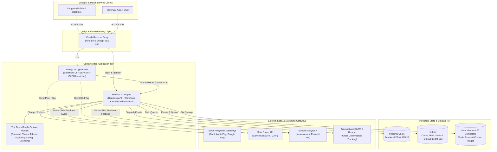
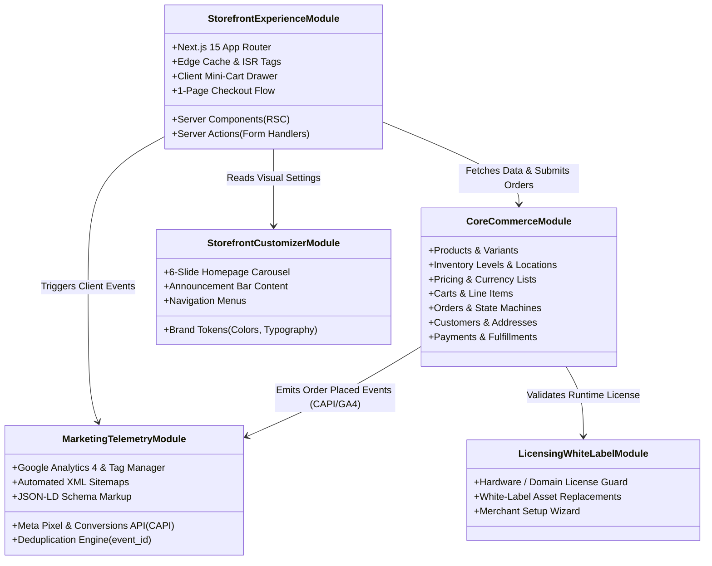

# System Architecture Specification

**Project**: The Ecom Buddy  
**Document**: System Architecture Specification  
**Status**: Approved for Architecture Review  
**Milestone**: 01 (Foundation & Technical Specification)  
**Author**: Principal Software Architect & Senior E-commerce Product Engineer  

---

## 1. Architectural Philosophy & Principles

The Ecom Buddy architecture is designed around four non-negotiable architectural pillars:

1. **Commerce Engine Reusability**: Commerce state machines (order calculations, multi-currency pricing, inventory reservation locks, discount hierarchies) are notoriously complex and error-prone. We leverage an established, battle-tested open-source commerce engine (**Medusa v2**) rather than reinventing core commerce primitives from scratch.
2. **Decoupled Headless Experience**: The merchant-facing storefront is separated from the commerce backend. A high-performance **Next.js 15 (App Router)** frontend delivers sub-second Server-Side Rendered (SSR) pages, instant static generation (ISR), and rich client interactions.
3. **Operational Simplicity for Independent Client Deployments**: Each client receives an isolated, independent deployment stack. To keep hosting costs negligible for SMB merchants ($10–$25/month) without needing dedicated DevOps engineers, the entire stack is orchestratable as a unified **Docker Compose** container bundle with automated SSL termination (Caddy) and single-command backups.
4. **Strict Modular Boundaries & Extensibility**: Custom product requirements (the 6-slide carousel, branding tokens, Meta Conversions API dual-tracking, one-time license verification) are encapsulated in dedicated extension modules rather than hacking the core commerce engine.



---

## 2. Commerce Engine Evaluation & Selection

### 2.1 The Build vs. Buy vs. Fork Analysis

| Evaluation Criterion | Custom Build (from Scratch) | WooCommerce / WordPress | Shopify (Headless API) | Medusa v2 (Selected) |
| :--- | :--- | :--- | :--- | :--- |
| **Business Model Alignment** | High initial engineering cost (\$50k+). | High plugin bloat, continuous maintenance fragility. | Violates requirement: enchains client to \$39-\$399/mo subscription. | **Perfect**: Open-source MIT, zero monthly vendor licensing tax. |
| **Commerce Primitives** | Must write cart, order, tax, multi-currency, and inventory logic. | Legacy relational schemas; prone to slow table locks. | Proprietary closed-source engine. | **Enterprise Ready**: Full DML models, location-based inventory, durable workflows. |
| **Client Deployment Model** | High maintenance burden. | Monolithic PHP/MySQL; heavy server footprint. | Multi-tenant SaaS cloud only (no private data ownership). | **Independent Deployments**: Single Docker Compose or modular cloud instances. |
| **Tech Stack Uniformity** | Custom. | PHP, MySQL, Apache/Nginx. | Ruby backend (closed), React frontend. | **100% TypeScript**: Node.js, Next.js, PostgreSQL. Uniform team skill set. |
| **Admin Interface** | Must build custom CMS & backoffice from scratch. | Cluttered WP-Admin with endless upsell banners. | Excellent SaaS admin, but locked to Shopify. | **Clean Embedded Admin**: React + Tailwind UI, customizable with widgets. |

### 2.2 In-Depth Medusa v2 Architecture Assessment
Medusa v2 introduces significant architectural upgrades that match **The Ecom Buddy** requirements:
* **DML (Data Modeling Layer)**: Facilitates declarative data models that automatically manage relational tables, foreign keys, and indexes via MikroORM/Postgres without raw SQL fragility.
* **Workflows Engine**: Long-running or multi-step operations (e.g., checkout completion: reserve stock $\rightarrow$ authorize payment $\rightarrow$ capture order $\rightarrow$ trigger CAPI $\rightarrow$ send receipt) are executed with **durable execution and automatic compensation (rollback) steps** if any stage fails.
* **Unified API & Admin Engine**: In Medusa v2, the Admin dashboard is bundled and served directly by the backend Node process via an optimized Vite build, eliminating the need to deploy and manage a third web server process.
* **Trade-Off Analysis & Mitigations**:
  * *Trade-Off*: Requires PostgreSQL and a key-value store (Redis).  
    *Mitigation*: For single-VPS independent client deployments, PostgreSQL 16 and Redis 7 run within the unified Docker Compose stack with isolated volumes and internal networking, requiring zero manual configuration by the merchant.
  * *Trade-Off*: Upstream updates can occasionally break customized schemas.  
    *Mitigation*: We isolate all platform-specific features (6-slide carousel, marketing credentials, licensing) inside an isolated module (`@ecom-buddy/module-core`), leaving core Medusa tables pristine.

---

## 3. Module Boundaries & Data Ownership

To guarantee strict separation of concerns, the architecture is partitioned into five distinct modules:



### 3.1 Data Ownership Matrix

| Data Domain | Responsible Module | Storage Location | Access Rule |
| :--- | :--- | :--- | :--- |
| **Catalog, SKUs, Stock** | `CoreCommerceModule` | PostgreSQL (`product*`, `inventory*`) | Read: Public via Storefront cache; Write: Authenticated Admin only |
| **Carts & Sessions** | `CoreCommerceModule` | PostgreSQL (`cart*`) / Redis cache | Read/Write: Public session with Cart Secret ID |
| **Orders & Transactions** | `CoreCommerceModule` | PostgreSQL (`order*`, `payment*`) | Read: Customer (own orders) / Admin; Write: Workflows Engine |
| **Carousel & Theme Config** | `StorefrontCustomizerModule` | PostgreSQL (`buddy_carousel`, `buddy_theme`) | Read: Public SSR / ISR; Write: Authenticated Admin only |
| **Marketing API Secrets** | `MarketingTelemetryModule` | PostgreSQL (`buddy_marketing_config`) | Read: Internal Server Services only (never exposed to browser) |
| **Client License State** | `LicensingWhiteLabelModule` | PostgreSQL (`buddy_license`) | Read/Write: Internal verification service on server boot |

---

## 4. Storefront Architecture (Next.js 15 App Router)

### 4.1 Rendering Strategy & Performance Optimization
* **Hybrid Static & Server Rendering**:
  * Homepage & Landing Pages: Incremental Static Regeneration (ISR) with on-demand tag revalidation (`revalidateTag('carousel')`, `revalidateTag('products')`).
  * Product Detail Pages (PDP): Dynamic SSR with edge-cached catalog payload.
  * Cart Drawer & Checkout: Client-side interactive hydration with React Server Actions for mutations.
* **Core Web Vitals Guarantees**:
  * **LCP (Largest Contentful Paint)**: Preloaded hero carousel image asset for Slide 1 with high `fetchpriority="high"` and responsive `<picture>` markup.
  * **CLS (Cumulative Layout Shift)**: Rigid aspect-ratio containers on all product cards, carousel slides, and image slots.
  * **INP (Interaction to Next Paint)**: Optimistic client updates on mini-cart line item changes using React 19 `useOptimistic`.

### 4.2 API Client & Caching Layer
* The Storefront communicates with Medusa via an auto-generated, type-safe REST SDK (`@medusajs/js-sdk`).
* Every fetch request from Next.js server components utilizes Next.js native `fetch` with cache tags:
  ```typescript
  // Example cached fetch with tag invalidation
  const product = await fetch(`${MEDUSA_BACKEND_URL}/store/products/${handle}`, {
    next: { tags: [`product-${handle}`, 'products'], revalidate: 3600 }
  });
  ```

---

## 5. Independent Client Deployment & Infrastructure

### 5.1 Deployment Model: Single-VPS All-In-One (Turnkey SMB Baseline)
For small and medium business owners, operational simplicity and zero monthly software tolls are paramount. The reference production environment is packaged as an isolated Docker Compose deployment.

```
/opt/the-ecom-buddy/
├── docker-compose.yml          # Unified multi-container orchestration
├── .env.production             # Encrypted merchant environment configuration
├── Caddyfile                   # Automatic Let's Encrypt TLS reverse proxy
├── data/
│   ├── postgres/               # Persistent database volume
│   ├── redis/                  # Persistent cache volume
│   └── uploads/                # Product images and assets
└── scripts/
    ├── backup.sh               # Automated daily pg_dump + media snapshot
    ├── restore.sh              # 1-command disaster recovery
    └── update.sh               # Safe rollback-capable container updater
```

#### Container Services Breakdown:
1. **`caddy`**: Reverse proxy handling port 80/443. Obtains and auto-renews TLS certificates from Let's Encrypt with zero manual intervention.
2. **`storefront`**: Node.js production container running the Next.js 15 standalone server build (port 3000).
3. **`backend`**: Node.js production container running Medusa v2 API + embedded Admin UI (port 9000).
4. **`postgres`**: PostgreSQL 16 container with tuned connection pooling and auto-vacuuming.
5. **`redis`**: Redis 7 container configured with append-only persistence (`AOF`).

### 5.2 Alternative Deployment Model: Decoupled Cloud PaaS
For clients preferring serverless management without managing a Linux VPS:
* **Frontend**: Vercel or Cloudflare Pages (Next.js App Router edge deployment).
* **Backend**: Railway or Render (Medusa v2 container with persistent worker).
* **Database**: Managed PostgreSQL on Neon, Supabase, or AWS RDS.
* **Redis**: Upstash Redis or managed Redis.
* **Media Storage**: AWS S3 or Cloudflare R2 bucket.

---

## 6. Security, Compliance & Data Protection

### 6.1 PCI-DSS SAQ-A Compliance
* Under no circumstances do raw payment card numbers (PAN), expiration dates, or CVV codes reach or transit through The Ecom Buddy application servers or databases.
* Payment forms utilize **Stripe Elements** (or Razorpay Checkout modal), which inject secure iframes hosted directly on the PCI-certified payment gateway domains.
* The application server handles only one-time payment tokens and webhook authorization events.

### 6.2 Data Privacy & Compliance (GDPR / CCPA / Consent Mode v2)
* The platform features a built-in, no-code **Consent Banner** respecting Google Consent Mode v2 (`analytics_storage`, `ad_storage`, `ad_user_data`, `ad_personalization`).
* Client-side Meta Pixel and Google Analytics scripts remain dormant until explicit user consent is registered or are dynamically gated based on regional privacy laws.
* Customer data export and "Right to be Forgotten" (account erasure) workflows are provided natively in the merchant admin.

### 6.3 Authentication & Session Security
* Admin authentication utilizes cryptographic HTTP-only, secure, `SameSite=Lax` cookies with Argon2 password hashing.
* Rate-limiting applied via Redis on sensitive endpoints (`/auth/token`, `/store/carts/*/payment-sessions`, `/contact`).
