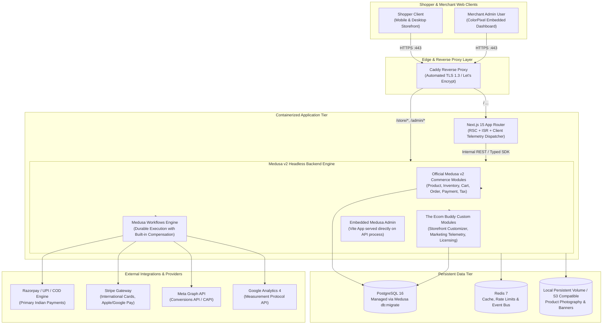
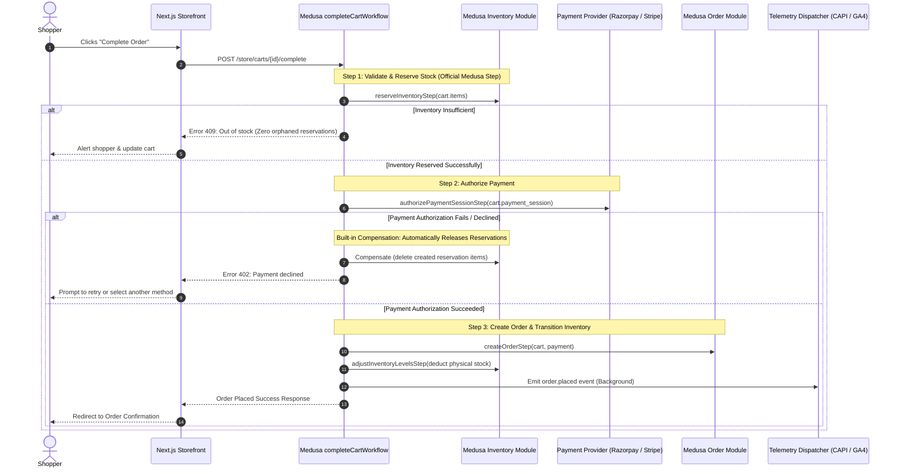
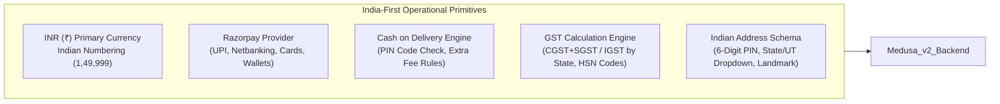

# System Architecture Specification

**Project**: The Ecom Buddy  
**Document**: System Architecture Specification  
**Status**: Revised Architecture Specification (Post-Review Revision)  
**Milestone**: 01 (Foundation & Technical Specification)  
**Author**: Principal Software Architect & Senior E-commerce Product Engineer  

---

## 1. Architectural Philosophy & Principles

The Ecom Buddy architecture is built upon four fundamental principles:

1. **Strict Data & Engine Integrity**: We strictly adhere to **Medusa v2**'s official modular architecture. We do **not** manually create, alter, or replace Medusa's core database tables. All core commerce domain models (products, variants, inventory, carts, orders, pricing, taxes) are owned and migrated solely by Medusa's official modules.
2. **Supported Extension Mechanisms**: Custom business requirements (dynamic carousel slides, brand styling tokens, marketing credentials, India-specific GST/HSN attributes, and licensing verification) are encapsulated within **officially registered Medusa v2 custom modules** utilizing Medusa's Data Modeling Layer (DML) and module links (`defineLink`).
3. **Decoupled Headless Experience**: The merchant-facing storefront is completely separated from the commerce backend, powered by **Next.js 15 (App Router)** utilizing React Server Components (RSC) and on-demand Incremental Static Regeneration (ISR).
4. **Operational Simplicity for Independent Client Deployments**: Each merchant client receives an isolated deployment stack orchestratable via **Docker Compose** with automated SSL termination (Caddy) and persistent PostgreSQL 16 and Redis 7 volumes.



---

## 2. Medusa v2 Data Ownership & Modular Architecture

### 2.1 Core Commerce Data Ownership
All core commerce tables are owned and managed exclusively by Medusa v2's official modules. Under no circumstances does The Ecom Buddy run manual SQL DDL to create or alter these tables.

* **Product Module (`@medusajs/medusa/product`)**: Owns `product`, `product_variant`, `product_option`, `product_option_value`, `product_category`, `product_collection`, `product_tag`, `product_image`.
* **Inventory Module (`@medusajs/medusa/inventory`)**: Owns `inventory_item`, `inventory_level`, `reservation_item`.
* **Stock Location Module (`@medusajs/medusa/stock-location`)**: Owns `stock_location`.
* **Pricing Module (`@medusajs/medusa/pricing`)**: Owns `price_set`, `price_list`, `price`, `price_rule`.
* **Cart Module (`@medusajs/medusa/cart`)**: Owns `cart`, `line_item`, `address`, `shipping_method`.
* **Order Module (`@medusajs/medusa/order`)**: Owns `order`, `order_change`, `order_item`, `order_summary`, `order_shipping_method`.
* **Payment Module (`@medusajs/medusa/payment`)**: Owns `payment_collection`, `payment_session`, `payment`, `refund`.
* **Fulfillment Module (`@medusajs/medusa/fulfillment`)**: Owns `shipping_option`, `fulfillment`, `tracking_info`.
* **Tax Module (`@medusajs/medusa/tax`)**: Owns `tax_region`, `tax_rate`, `tax_rate_rule`.
* **Customer Module (`@medusajs/medusa/customer`)**: Owns `customer`, `customer_address`, `customer_group`.
* **Promotion Module (`@medusajs/medusa/promotion`)**: Owns `promotion`, `campaign`, `promotion_rule`.

### 2.2 Custom Extension Modules (The Ecom Buddy Modules)
Custom requirements are implemented as registered custom modules using Medusa's **Data Modeling Layer (DML)** (`model.define`):

1. **`@ecom-buddy/store-customizer` Module**:
   * Owns `carousel_slide`: Dynamic homepage carousel slides (pre-seeded with 6 default slides, fully dynamic add/edit/reorder).
   * Owns `theme_settings`: Merchant branding tokens (colors, typography presets, announcement bar).
2. **`@ecom-buddy/marketing-telemetry` Module**:
   * Owns `marketing_credentials`: Encrypted storage for Meta Pixel ID, Meta CAPI System User Token, GA4 Measurement ID, Measurement Protocol Secret, and GTM Container ID.
   * Manages default privacy and region-aware consent gating.
3. **`@ecom-buddy/licensing` Module**:
   * Owns `license_record`: Cryptographic signature verification for domain-bound one-time software licenses.
4. **India GST Extension via Module Links**:
   * Using Medusa's official `defineLink`, we link product models to custom GST attributes:
     ```typescript
     import { defineLink } from "@medusajs/framework/utils";
     import ProductModule from "@medusajs/medusa/product";
     import IndiaTaxModule from "./modules/india-tax";

     export default defineLink(
       ProductModule.linkable.product,
       IndiaTaxModule.linkable.gstProductDetail
     );
     ```

### 2.3 Corrected Data Ownership Matrix

| Data Domain | Responsible Module | Extension Mechanism | DB Management |
| :--- | :--- | :--- | :--- |
| **Catalog (500+ Products & SKUs)** | Medusa Core Product Module | Standard Medusa API & Seed | Medusa CLI (`medusa db:migrate`) |
| **Inventory & Reservations** | Medusa Core Inventory Module | Medusa Native Reservation Workflows | Medusa CLI (`medusa db:migrate`) |
| **Carts, Addresses, Line Items** | Medusa Core Cart Module | Standard Medusa Cart API | Medusa CLI (`medusa db:migrate`) |
| **Orders & Transactions** | Medusa Core Order Module | Medusa Workflows (`completeCartWorkflow`) | Medusa CLI (`medusa db:migrate`) |
| **Payments & Refunds** | Medusa Core Payment Module | Payment Provider Plugins (Razorpay/Stripe) | Medusa CLI (`medusa db:migrate`) |
| **GST / HSN Details** | Custom `india-tax` Module | Module Link (`defineLink`) | Medusa CLI (`medusa db:migrate`) |
| **Carousel Slides & Theme** | Custom `store-customizer` Module | DML (`model.define`) | Medusa CLI (`medusa db:migrate`) |
| **Marketing API Tokens** | Custom `marketing-telemetry` Module | DML (`model.define`) | Medusa CLI (`medusa db:migrate`) |
| **License Validation** | Custom `licensing` Module | DML (`model.define`) | Medusa CLI (`medusa db:migrate`) |

---

## 3. Checkout, Inventory & Payment Orchestration

### 3.1 Eliminating Conflicting Custom Logic
The previous draft proposed a custom SQL-level reservation lock and a custom cron cleanup worker. This has been **completely removed**. 

Instead, the platform relies exclusively on Medusa v2's native **`completeCartWorkflow`** and official inventory reservation primitives:



### 3.2 Payment Retries, Webhook Idempotency & Reconciliation
* **Webhook Idempotency**: Payment provider webhooks (e.g., Razorpay `payment.captured` or Stripe `payment_intent.succeeded`) are processed through Medusa's idempotent event handlers. The transaction ID and idempotency key prevent duplicate order creation if both client-side redirect and server webhook arrive concurrently.
* **Payment Failure & Retries**: When an authorization attempt fails, the shopper's cart remains active, the reserved inventory is immediately released by the workflow compensation step, and the shopper can retry with UPI, Netbanking, or another card.
* **Reconciliation**: A scheduled Medusa reconciliation workflow checks pending payment sessions older than 30 minutes against the Razorpay/Stripe API, finalizing any orphaned orders or releasing abandoned carts cleanly.

---

## 4. India-First Architecture Implementation

The architecture incorporates first-class support for Indian e-commerce operational requirements:



* **GST Split Logic**: Evaluated during tax calculation:
  $$\text{Tax Mode} = \begin{cases} \text{CGST} + \text{SGST} & \text{if } \text{State}_{\text{Merchant}} = \text{State}_{\text{Customer}} \\ \text{IGST} & \text{if } \text{State}_{\text{Merchant}} \ne \text{State}_{\text{Customer}} \end{cases}$$
* **B2B Invoicing**: Stores customer GSTIN and outputs tax-compliant PDF invoices with clear tax breakdowns.

---

## 5. Independent Client Deployment & Lifecycle

### 5.1 Turnkey Single-VPS Docker Compose Architecture
Each client receives an independent, self-contained deployment stack. The production container bundle consists of:

```
/opt/the-ecom-buddy/
├── docker-compose.yml          # Container orchestration
├── .env.production             # Client-specific environment configuration
├── Caddyfile                   # Reverse proxy with automated TLS 1.3
├── data/
│   ├── postgres/               # Persistent database volume (PostgreSQL 16)
│   ├── redis/                  # Persistent cache & event bus volume (Redis 7)
│   └── uploads/                # Local asset & media storage
└── scripts/
    ├── backup.sh               # Automated daily pg_dump + asset backup
    └── restore.sh              # Disaster recovery restoration
```

### 5.2 Early Validation of Deployment Assumptions
To prevent unexpected deployment blockers in final milestones:
* **Milestone 02**: Validates Docker container builds for Medusa v2 backend and PostgreSQL database connectivity early.
* **Milestone 03**: Validates persistent volume mounting, database migrations (`medusa db:migrate`), and memory profiling on a baseline 4GB container environment.
